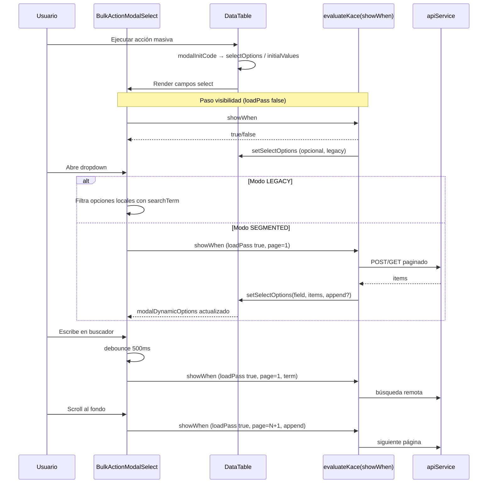

# DataTable — Selects del modal de acciones masivas con búsqueda y scroll infinito

**Fecha:** 2026-07-02  
**Rama:** `feature/data-table-bulk-modal-select-search-infinite-scroll`  
**Alcance:** `apps/onescript_plugin_kace/src/plugins/kace/components/data-table/`

## Objetivo

Reemplazar los `<select>` nativos del modal de acciones masivas del DataTable por un componente con input de búsqueda y scroll infinito, alineado con el patrón de `CustomSelect` / `CustomMultiselect`. La búsqueda debe poder consultar la API cuando el script lo soporte, manteniendo compatibilidad con scripts existentes que cargan listas completas vía `setSelectOptions`.

## Decisiones acordadas

| Decisión | Elección |
|----------|----------|
| Alcance UI | **A** — Todos los campos `select` del modal usan el nuevo componente |
| Compatibilidad scripts | **A3** — Legacy (búsqueda local) + contrato paginado para scripts actualizados |
| Ubicación de la carga | **B3 revisado** — Un solo textarea `showWhen`; sin `optionsLoadCode` nuevo |
| Implementación técnica | **Enfoque 1** — Extraer núcleo compartido desde `CustomSelect` |

## Arquitectura

### Componentes

```
DataTable.jsx
  └── BulkActionModalSelect (nuevo, por fieldType === 'select')
        └── useKaceScriptSelect (hook extraído / compartido con CustomSelect)
              ├── useKaceScriptSelectLoad
              ├── useDebouncedStableTerm
              └── evaluateKace(showWhen) en dos modos
```

### Modos de operación

#### Modo LEGACY (sin señales de paginación)

- **Origen de opciones:** `field.options`, `modalInitCode` → `selectOptions`, o `setSelectOptions(fieldKey, array)` desde `showWhen`.
- **Búsqueda:** filtro local sobre el array cargado (case-insensitive en `label`).
- **Scroll infinito:** no aplica.
- **Scripts existentes:** sin cambios obligatorios.

#### Modo SEGMENTED (contrato paginado)

Se activa cuando el script usa cualquiera de:

- `loadPass === true` y responde con `setSelectOptions(..., { append: true })`, o
- `kaceSelectPage > 1`, o
- `kaceRemoteSearchTerm` no vacío tras debounce.

Comportamiento:

- **Búsqueda remota:** debounce 500 ms; cada término estable reinicia `page = 1` y vuelve a evaluar `showWhen` con `loadPass: true`.
- **Scroll infinito:** al acercarse al fondo del dropdown (`isKaceSelectScrollNearBottom`), incrementa `kaceSelectPage` y re-evalúa con `append: true`.
- **`pageSize`:** default 20 (configurable por constante compartida con Custom Select).

### Invocación dual de `showWhen`

| Paso | Cuándo | `loadPass` | Retorno esperado |
|------|--------|------------|------------------|
| Visibilidad | Render modal / cambio `modalFormData` | `false` | `true` / `false` |
| Carga | Abrir dropdown, búsqueda debounced, scroll | `true` | Ignorado para visibilidad; script carga opciones |

### Contexto extendido en `showWhen`

Variables existentes (sin cambios): `modalFormData`, `kaceEngine`, `apiService`, `selectedRows`, `selectedCount`, `data`, `component`, `Swal`, `setFieldValue`.

Variables nuevas:

| Variable | Tipo | Descripción |
|----------|------|-------------|
| `loadPass` | `boolean` | `true` en invocaciones de carga paginada |
| `kaceSelectPage` | `number` | Página actual (base 1) |
| `kaceRemoteSearchTerm` | `string` | Término de búsqueda debounced |
| `kaceSelectPageSize` | `number` | Tamaño de página (default 20) |

`setSelectOptions` ampliado:

```javascript
setSelectOptions(fieldKey, optionsArray)
setSelectOptions(fieldKey, optionsArray, { append: true })
setSelectOptions(fieldKey, optionsArray, { replace: true })
```

- Sin tercer argumento: reemplaza opciones (legacy).
- `{ append: true }`: concatena (paginación).
- `{ replace: true }`: reemplaza en paso de carga (p. ej. nueva búsqueda en page 1).

## Flujo de datos



### Dependencias entre campos (ej. user → group)

1. Cambio en `modalFormData.user` dispara re-evaluación de visibilidad de `group`.
2. El select dependiente resetea: `page = 1`, `searchTerm = ''`, invalida caché de carga segmentada.
3. Si `group` entra en modo segmented, la primera carga ocurre al abrir su dropdown.

### `modalInitCode` y selects estáticos

- Opciones precargadas vía `{ selectOptions: { state: [...] } }` se tratan como **legacy** (búsqueda local).
- Caso típico: **Cambiar estado** — lista pequeña de transiciones disponibles; no requiere paginación API.

## UI / UX

- Reutilizar estilos de `CustomSelect.css` / clases compartidas (`kace-select-loader`, dropdown sticky con buscador).
- Placeholder del campo: `field.placeholder` o constante existente `BULK_ACTION_MODAL_SELECT_PLACEHOLDER`.
- Dropdown: `maxHeight: 280px`, scroll vertical.
- Estados: loading inicial, loading en paginación (inline), lista vacía, error silencioso en consola.
- Accesibilidad: `aria-expanded`, `aria-label` en buscador, foco preservado en input tras carga remota (mismo patrón que CustomSelect).

## Manejo de errores

| Escenario | Comportamiento |
|-----------|----------------|
| `showWhen` lanza en paso visibilidad | Campo oculto (como hoy) |
| `showWhen` lanza en paso carga | `console.warn`, mantener opciones previas, quitar loading |
| API falla en script | Responsabilidad del script; componente no intercepta |
| `setSelectOptions` con array vacío en page > 1 | Marcar `hasMore = false` (stall infinito) |
| Valor seleccionado no está en catálogo | Mantener opción temporal en trigger ( `ensureSelectedOption` ) |
| Modal cierra | Resetear estado interno del select (search, page, caché) |

## Archivos a modificar

| Archivo | Cambio |
|---------|--------|
| `data-table/DataTable.jsx` | Sustituir `<select>` del modal por `BulkActionModalSelect`; ampliar `setSelectOptionsForContext` con `append`/`replace` |
| `data-table/BulkActionModalSelect.jsx` | Nuevo componente |
| `hooks/useKaceScriptSelect.js` | Hook compartido (extraído de CustomSelect) |
| `components/custom-select/CustomSelect.jsx` | Refactor para usar hook compartido (sin cambio de comportamiento) |
| `data-table/acciones.form.json` | Documentar variables `loadPass`, paginación y `setSelectOptions` con opciones |
| `data-table/schema.json` | Migrar `showWhen` de `user` y `group` (Reasignar) al contrato paginado |
| Tests | `BulkActionModalSelect.test.jsx`, ajustes en hook si aplica |

## Migración del schema de ejemplo

### Reasignar — campo `user`

- Mover lógica de `/users/search` al bloque `if (loadPass)`.
- Filtro `ilike` sobre `nombres` / apellidos usando `kaceRemoteSearchTerm`.
- Paginación: `limit: kaceSelectPageSize`, `offset: (kaceSelectPage - 1) * kaceSelectPageSize`.
- Bloque visibilidad: solo `return modalFormData.asignamentType === 'user'`.

### Reasignar — campo `group`

- Carga paginada en `loadPass` cuando `modalFormData.user` está definido.
- Depende de `usuario_id` en filtros; búsqueda remota sobre nombre de grupo si la API lo permite.

### Cambiar estado — campo `state`

- Sin cambios en script; búsqueda local sobre opciones de `modalInitCode`.

## Testing

### Unitarios

- Modo legacy: filtra opciones localmente; no dispara `loadPass`.
- Modo segmented: debounce de término, incremento de página en scroll, `append` vs `replace`.
- `setSelectOptions` con `{ append: true }` concatena sin duplicar por `value`.
- Reset al cambiar dependencia (`user` → limpia estado de `group`).
- Valor seleccionado visible aunque no esté en página actual.

### Integración manual

1. Reasignar → abrir select Usuario → buscar por nombre → scroll hasta cargar más páginas.
2. Seleccionar usuario → abrir Grupo → verificar recarga dependiente.
3. Cambiar estado → buscar localmente entre pocos estados.
4. Acción con select estático en `field.options` → búsqueda local funciona.

## Fuera de alcance

- Multiselect en modal de acciones masivas (solo single select).
- Cambios en APIs backend.
- Select de la barra de acciones masivas (selector de acción, no campos del modal).
- Flags opt-in por campo en builder (decisión A: automático para todos).

## Criterios de aceptación

1. Todo `fieldType: select` del modal renderiza buscador y dropdown con scroll.
2. Scripts legacy sin paginación siguen funcionando con búsqueda local.
3. Scripts con `loadPass` + params de paginación soportan búsqueda API y scroll infinito.
4. Documentación del builder actualizada en `acciones.form.json`.
5. Schema de Reasignar migrado para usuarios y grupos con paginación.
6. Tests unitarios pasan; CustomSelect sin regresiones.
