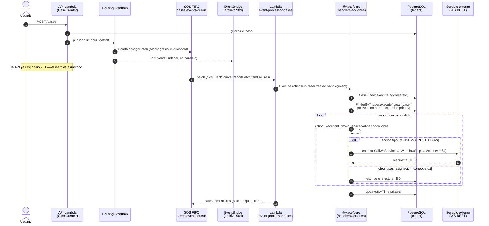
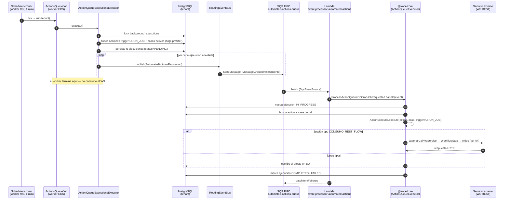

# Flujos End-to-End — `CaseCreated` y `ActionsQueueJob` (con consumo de WS REST)

> Complemento de [`EVENTS_FLOW_DIAGRAM.md`](./EVENTS_FLOW_DIAGRAM.md), [`EVENT_PROCESSOR.md`](./EVENT_PROCESSOR.md),
> [`WORKERS_AND_SCHEDULED_TASKS.md`](./WORKERS_AND_SCHEDULED_TASKS.md) y [`WORKER_JOBS.md`](./WORKER_JOBS.md).
> Aquí se trazan **dos recorridos completos** del sistema, desde el disparador hasta la **llamada HTTP
> saliente a un servicio externo (WS REST)**, mostrando los saltos de proceso y de transporte.

---

## 1. Las dos formas de llegar a un WS REST

Ambos flujos terminan ejecutando una **acción de tipo `CONSUMO_REST_FLOW`**, que invoca un servicio
web externo vía la misma cadena (§4). Pero **llegan por caminos arquitectónicamente distintos**:

| | `CaseCreated` | `ActionsQueueJob` |
|---|---|---|
| **Disparador** | Usuario crea un caso (API HTTP) | Cron interno del worker (cada 1 min) |
| **Productor del evento** | API Lambda (`CaseCreator`) | Worker ECS servicio `fast` |
| **Evento de dominio** | `CaseCreated` | `AutomatedActionsRequested` (uno por ejecución encolada) |
| **Cola SQS FIFO** | `*-cases-events-queue.fifo` | `*-automated-actions-events-queue.fifo` |
| **Lambda consumidora** | `event-processor-cases` | `event-processor-automated-actions` |
| **¿Quién busca las acciones?** | La **Lambda** (`FinderByTrigger`, trigger `crear_caso`) | El **worker** (las encola en `actions_queue_executions`); la Lambda solo ejecuta una ejecución ya resuelta |
| **¿Dónde corre el consumo del WS?** | Dentro de `event-processor-cases` | Dentro de `event-processor-automated-actions` |

> **Diferencia clave:** en `CaseCreated` la API emite **un** evento y la Lambda hace todo (buscar +
> ejecutar + WS). En `ActionsQueueJob` el worker **precalcula y persiste** N ejecuciones y emite **N
> eventos** (uno por acción×caso); cada uno se ejecuta de forma aislada en la Lambda. Es un patrón de
> *fan-out con cola de trabajo durable* (`actions_queue_executions`).

---

## 2. Flujo E2E — `CaseCreated`

### Pasos (resumen)
1. **API (in-process):** `CaseCreator` guarda el caso y publica `CaseCreated` con
   `EventPublisher.publishAll()`. La respuesta HTTP al usuario **no espera** el procesamiento posterior.
2. **Transporte:** `RoutingEventBus` enruta a `*-cases-events-queue.fifo` (`MessageGroupId = caseId`,
   `MessageDeduplicationId = eventId`) y en paralelo hace `PutEvents` al bus de archivo (sidecar).
3. **Consumo (Lambda `event-processor-cases`):** el motor compartido deduplica y llama
   `ExecuteActionsOnCaseCreated.handle(event)` (ver [`EVENT_PROCESSOR.md`](./EVENT_PROCESSOR.md)).
4. **Resolución de acciones:** obtiene el caso (`CaseFinder`) y busca las acciones con trigger
   `crear_caso` (`FinderByTrigger`: activas, no borradas, ordenadas por prioridad).
5. **Ejecución:** `ActionExecutionDomainService` itera; por cada acción válida llama al `ActionExecutor`.
   Si la acción es **`CONSUMO_REST_FLOW`** entra a la cadena de WS (§4); si no, aplica su efecto en BD
   (asignación de grupo/asesor, envío de correo, actualización de modelo, etc.).
6. **SLA:** tras las acciones, `updateSLATimers(kase)`.

> **Importante:** para `CaseCreated`, el consumo del WS ocurre **dentro de la misma Lambda
> `event-processor-cases`** — no hay otra cola ni Lambda intermedia en este camino.

---

## 3. Flujo E2E — `ActionsQueueJob` (worker → WS)

### Pasos (resumen)
1. **Worker (in-process):** el `Scheduler` dispara `ActionsQueueJob.run(tenant)` cada minuto, que
   ejecuta `ActionQueueExecutionsExecutor.execute()`.
2. **Encolado durable:** toma el lock `background_executions`, busca acciones con trigger `CRON_JOB` y
   los casos activos (con SQL prefilter), y **persiste una fila por ejecución** en
   `actions_queue_executions` con `status = PENDING`.
3. **Fan-out de eventos:** por **cada** ejecución persistida emite un `AutomatedActionsRequested`
   (`payload: { executionId, actionId, caseId, clientId, triggerType }`) a
   `*-automated-actions-events-queue.fifo`. **El worker no consume el WS** — su trabajo termina al emitir.
4. **Consumo (Lambda `event-processor-automated-actions`):** `ProcessActionQueueOnCronJobRequested`
   extrae el payload y delega en `ActionQueueExecutor`.
5. **Ejecución de una ejecución:** marca la fila `IN_PROGRESS`, resuelve `action` + `case` por id, y
   llama al `ActionExecutor` con trigger `CRON_JOB`. Si la acción es **`CONSUMO_REST_FLOW`** entra a la
   cadena de WS (§4); si no, aplica el efecto en BD.
6. **Cierre:** marca la fila `COMPLETED` o `FAILED` en `actions_queue_executions`.

---

## 4. La cadena compartida de "consumo de WS" (acción `CONSUMO_REST_FLOW`)

Los dos flujos convergen aquí. Una vez que el `ActionExecutor` detecta una acción de tipo
`CONSUMO_REST_FLOW`, instancia un `CallWsService` y ejecuta el workflow REST asociado:

```mermaid
flowchart TD
    AE[ActionExecutor detecta<br/>CONSUMO_REST_FLOW] --> CWS[CallWsService.execute&#40;entity, action&#41;]
    CWS --> F[Obtiene WSRestFlow por id<br/>+ arma initial_context del caso]
    F --> WSE[WorkflowStepExecutorService.execute&#40;flow_id, initial_context&#41;]
    WSE --> STEPS[Carga e itera los steps del flujo]
    STEPS --> EP{tipo de step}
    EP -->|endpoint| PREP["prepareRequestConfig:<br/>reemplaza SECRET_* (SecretsVault)<br/>+ contenido dinámico del contexto"]
    EP -->|function / conditional| OTRO[lógica interna<br/>sin HTTP saliente]
    PREP --> AX[AxiosHttpClient.request]
    AX --> VC[Verifica AllowedConnections<br/>+ certificate pinning si aplica]
    VC --> HTTP[axios.request → HTTP SALIENTE]
    HTTP --> WS[(Servicio externo)]
    RESP["Procesa respuesta:<br/>hooks on_success / on_error<br/>actualiza contexto global"]
    WS --> RESP
    RESP --> STEPS

    style HTTP fill:#9d4edd,color:#fff
    style WS fill:#6c757d,color:#fff
    style AX fill:#1d3557,color:#fff
```

### Componentes de la cadena

| Componente | Archivo (`packages/kace_cloud_core/src/...`) | Rol |
|---|---|---|
| `ActionExecutor` | `shared/domain/services/ActionExecutor.js` | Dispatch por `action_type`; crea `CallWsService` para `CONSUMO_REST_FLOW` |
| `CallWsService` | `actions/domain/types/CallWsService.js` | Resuelve el `WSRestFlow`, arma el `initial_context` (datos del caso/entidad) y lanza el workflow |
| `WorkflowStepExecutorService` | `shared/domain/services/WorkflowStepExecutorService.js` | Carga e itera los *steps*; ejecuta endpoints/funciones/condicionales; gestiona hooks y contexto global |
| `AxiosHttpClient` | `shared/infrastructure/http/AxiosHttpClient.js` | **Hace la llamada HTTP saliente** (axios), validando `AllowedConnections` y *certificate pinning* |
| `KnexAllowedConnectionsRepository` | `allowed-conections/...` | Lista blanca de dominios externos permitidos (se rechaza si no está) |
| `KnexSecretsVaultRepository` | `secrets-vault/infrastructure/persistence/...` | Provee los secretos para reemplazar `SECRET_*` en URL/headers/body |

### Notas
- **Seguridad de salida:** antes de cada request, `AxiosHttpClient` verifica que el dominio esté en
  `allowed_connections`; si está configurado SSL pinning, valida el fingerprint SHA-256 del certificado.
- **Plantillas:** la URL/headers/body del endpoint se resuelven reemplazando **secretos**
  (desde el vault) y **contenido dinámico** desde el contexto del workflow (datos del caso, respuestas
  de steps previos).
- **Multi-step:** un `WSRestFlow` puede tener varios steps; la respuesta de uno alimenta el contexto
  del siguiente. Los hooks `on_success` / `on_error` controlan el encadenamiento.
- **Auditoría:** al terminar, se registra un evento de log `ws-rest-flows.executed` con el resumen.

> ℹ️ Esta cadena (acción `CONSUMO_REST_FLOW` → `CallWsService` → `WorkflowStepExecutorService`) es
> **distinta** del evento de dominio `WSRestFlowExecutionRequested` / Lambda `event-processor-ws-rest`,
> que cubre el disparo de flujos REST por **webhook/hook externo** (no desde acciones automatizadas de
> caso). Ambos terminan llamando a un WS externo, pero por rutas separadas.

---

## 5. Referencias de código

| Flujo | Punto de entrada |
|---|---|
| `CaseCreated` (productor) | `@kace/core` → `cases/application/create/CaseCreator.js` |
| `CaseCreated` (consumidor) | `event-processor/src/cases/handler.mjs` → `cases/application/event-handlers/ExecuteActionsOnCaseCreated.js` |
| Resolución de acciones | `actions/domain/services/FinderByTrigger.js`, `actions/domain/ActionExecutionDomainService.js` |
| `ActionsQueueJob` (productor) | `apps/workers/.../src/jobs/ActionsQueueJob.mjs` → `actions-queue-executions/application/executions/ActionQueueExecutionsExecutor.js` |
| `ActionsQueueJob` (consumidor) | `event-processor/src/automated-actions/handler.mjs` → `actions-queue-executions/application/event-handlers/ProcessActionQueueOnCronJobRequested.js` |
| Cadena WS REST | `actions/domain/types/CallWsService.js` → `shared/domain/services/WorkflowStepExecutorService.js` → `shared/infrastructure/http/AxiosHttpClient.js` |
