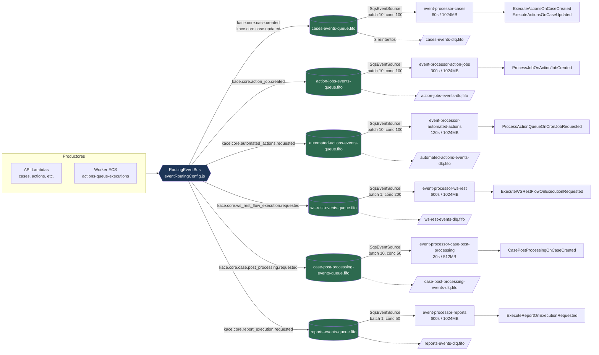

# Mapa de Eventos — Diagrama para Revisión con el Equipo

> Snapshot del flujo de eventos de dominio en KACE Cloud, desde la publicación en `@kace/core`
> hasta el consumo por las Lambdas del `event-processor`.
> Generado a partir del código en `packages/kace_cloud_core` y `apps/apiv1/kace_cloud_api_event_processor`.
>
> 📄 **Detalle del consumidor:** ver [`EVENT_PROCESSOR.md`](./EVENT_PROCESSOR.md) — el motor compartido, la deduplicación idempotente, el manejo de fallos parciales y la infraestructura de las 6 Lambdas.
> 📄 **Flujos E2E:** ver [`E2E_FLOWS.md`](./E2E_FLOWS.md) — recorridos completos de `CaseCreated` y `ActionsQueueJob` hasta el consumo de un WS REST externo.

---

## 1. Resumen en una frase

Cada *use case* (ej. `CaseCreator`) graba eventos de dominio en su agregado y los publica con
`EventPublisher.publishAll()`. Detrás, el **`RoutingEventBus`** hace **dos cosas en paralelo**:

1. **SQS FIFO** (transporte principal) → enruta cada evento a la cola correcta según su `eventName` → la Lambda `event-processor` lo consume.
2. **EventBridge** (sidecar de archivo/auditoría) → `PutEvents` al bus `kace.core` con retención de 90 días para replay.

> ⚠️ **Nota para el equipo:** aunque `CLAUDE.md` menciona RabbitMQ en el stack, **no existe RabbitMQ en el código**. El transporte real es **SQS FIFO + EventBridge**.

---

## 2. Diagrama de flujo de publicación (productor)

```mermaid
flowchart TD
    subgraph API["API Lambda (apps/apiv1/*)"]
        H[handler.mjs<br/>withTenantContext] --> C[controller.mjs]
        C -->|new CaseCreator&#40;...eventPublisher&#41;| UC[Use Case<br/>CaseCreator / CaseUpdater / etc.]
    end

    subgraph CORE["@kace/core"]
        UC -->|recordDomainEvent&#40;new CaseCreated&#41;| AGG[AggregateRoot<br/>pullDomainEvents&#40;&#41;]
        AGG -->|publishAll&#40;events&#41;| EP[EventPublisher<br/>application/events]
        EP -->|publishBatch&#40;events&#41;| RB[RoutingEventBus<br/>infrastructure/events]
    end

    RB -->|agrupa por eventName<br/>SendMessageBatch| SQS[(SQS FIFO<br/>cola por tipo de evento)]
    RB -.->|PutEvents en paralelo<br/>source: kace.core| EB[(EventBridge Bus<br/>archive 90d)]

    style SQS fill:#2d6a4f,color:#fff
    style EB fill:#5a189a,color:#fff
    style RB fill:#1d3557,color:#fff
```



**Construcción del bus:** `BaseController.#buildEventPublisher()` →
`buildRoutingEventBusFromTenant(tenant)` lee del **Tenant** las URLs de cola, la región y el
nombre del bus de EventBridge. Es **multi-tenant**: cada tenant tiene sus propias colas.

---

## 3. Diagrama de routing: Evento → Cola → Lambda (consumidor)



---

## 4. Tabla resumen: Evento → Cola → Lambda → Acción

| Evento de dominio (`eventName`) | Módulo `@kace/core` | Cola SQS FIFO | Lambda consumidora | Acción / Handler |
|---|---|---|---|---|
| `kace.core.case.created` | `cases` | `*-cases-events-queue.fifo` | `event-processor-cases` | `ExecuteActionsOnCaseCreated` |
| `kace.core.case.updated` | `cases` | `*-cases-events-queue.fifo` | `event-processor-cases` | `ExecuteActionsOnCaseUpdated` |
| `kace.core.action_job.created` | `action-jobs` | `*-action-jobs-events-queue.fifo` | `event-processor-action-jobs` | `ProcessJobOnActionJobCreated` |
| `kace.core.automated_actions.requested` | `actions-queue-executions` | `*-automated-actions-events-queue.fifo` | `event-processor-automated-actions` | `ProcessActionQueueOnCronJobRequested` |
| `kace.core.ws_rest_flow_execution.requested` | `ws-rest-flow-executions` | `*-ws-rest-events-queue.fifo` | `event-processor-ws-rest` | `ExecuteWSRestFlowOnExecutionRequested` |
| `kace.core.case.post_processing.requested` | `cases` | `*-case-post-processing-events-queue.fifo` | `event-processor-case-post-processing` | `CasePostProcessingOnCaseCreated` |
| `kace.core.report_execution.requested` | `report-executions` | `*-reports-events-queue.fifo` | `event-processor-reports` | `ExecuteReportOnExecutionRequested` |

> El prefijo `*` corresponde a `{serviceName}` definido en el stack CDK del `event-processor`.

---

## 5. Estructura del mensaje publicado

**Cuerpo del mensaje SQS (`MessageBody`)** — JSON producido por `DomainEvent.toJson()`:

```json
{
  "eventId": "uuid-v4",
  "eventName": "kace.core.case.created",
  "aggregateId": "uuid-del-caso",
  "occurredOn": "2026-06-03T12:34:56.789Z",
  "payload": {
    "clientId": "uuid",
    "responsibleId": "uuid",
    "classificationId": "uuid",
    "groupId": "uuid",
    "transitionId": "uuid"
  },
  "metadata": {
    "tenant_id": "uuid",
    "user_id": "uuid",
    "correlation_id": null,
    "causation_id": null
  }
}
```

**Atributos FIFO (clave para ordenamiento y dedup):**

| Campo SQS | Valor | Propósito |
|---|---|---|
| `MessageGroupId` | `event.aggregateId` | Garantiza orden **por caso/agregado** |
| `MessageDeduplicationId` | `event.eventId` | Evita duplicados (ventana de 5 min) |
| `MessageAttributes.eventName` | `kace.core.case.created` | Routing / observabilidad |
| `MessageAttributes.tenantId` | `<tenant-id>` | Aislamiento multi-tenant |

**Evento espejo en EventBridge (`PutEvents`):**

```text
Source:        kace.core
DetailType:    <eventName>            (ej. kace.core.case.created)
Detail:        <JSON completo del evento>
EventBusName:  <bus del tenant>
Resources:     [aggregateId]
Time:          occurredOn
```

---

## 6. Inventario de eventos de dominio (estado actual)

Actualmente existen **7 eventos de dominio** definidos en `@kace/core`:

| # | Evento | Payload principal | Productor (use case / lambda) |
|---|---|---|---|
| 1 | `CaseCreated` | clientId, responsibleId, classificationId, groupId, transitionId | `CaseCreator` |
| 2 | `CaseUpdated` | trigger, changedAttributes | `CaseUpdater`, `CaseTransitionsUpdater`, `CaseUserAssigner` |
| 3 | `CasePostProcessingRequested` | parentId (aggregateId = caseId) | `cases` lambda (`casePostProcessingPublisher.mjs`) |
| 4 | `ActionJobCreated` | type, actionId, restflowId, totalRecords | `ActionJobCreator` |
| 5 | `AutomatedActionsRequested` | executionId, actionId, caseId, clientId, triggerType | `ActionQueueExecutionsExecutor` |
| 6 | `WSRestFlowExecutionRequested` | flowId, externalCode, initialContext | (ws-rest-flow-executions) |
| 7 | `ReportExecutionRequested` | reportName, parameters (aggregateId = executionId) | `reports` / `report_executions` lambdas |

Todos heredan de `DomainEvent` (`shared/domain/events/DomainEvent.js`) y se graban vía
`AggregateRoot.recordDomainEvent()`.

> **Nota de routing:** el mapa `eventName → cola` vive en `eventRoutingConfig.js`. Seis de los siete
> eventos son de validación **estricta** (fail-fast si falta la URL de cola en el `Tenant`); la entrada
> de `kace.core.case.post_processing.requested` es **tolerante** (se omite si el tenant aún no tiene
> `aws_case_post_processing_queue_url` poblada, para no romper la publicación del resto de eventos).

---

## 7. Componentes clave (rutas de código)

| Componente | Archivo | Responsabilidad |
|---|---|---|
| `EventPublisher` | `core/src/shared/application/events/EventPublisher.js` | API de aplicación (`publishAll`) |
| `RoutingEventBus` | `core/src/shared/infrastructure/events/RoutingEventBus.js` | Routing por `eventName` a SQS + sidecar EventBridge |
| `EventBridgeEventBus` | `core/src/shared/infrastructure/events/EventBridgeEventBus.js` | `PutEvents` (archivo) |
| `eventRoutingConfig.js` | `core/src/shared/infrastructure/events/eventRoutingConfig.js` | Mapa `eventName → cola` |
| `buildRoutingEventBusFromTenant.js` | `core/src/shared/infrastructure/events/` | Factory multi-tenant |
| `BaseController.#buildEventPublisher` | `kace_cloud_api_common/src/controllers/BaseController.js` | Inyección del publisher |
| Stack del consumidor | `apps/apiv1/kace_cloud_api_event_processor/lib/event-processor-stack.ts` | 6 Lambdas + colas FIFO + DLQ + bus |
| Handlers consumidores | `apps/apiv1/kace_cloud_api_event_processor/src/{cases,action-jobs,automated-actions,ws-rest,case-post-processing,reports}/handler.mjs` | Routing `eventName → action handler` |

---

## 8. Detalles operativos (SQS / EventBridge)

- **Colas:** FIFO, long polling (`receiveMessageWaitTime: 20s`), visibilidad = `timeout × 6`. Las colas principales usan `contentBasedDeduplication: false` — la dedup es **explícita** vía `MessageDeduplicationId = eventId` (ver §5).
- **DLQ:** tras **3 intentos**, retención **14 días**, `contentBasedDeduplication: true`.
- **EventBridge Archive:** patrón `source: ['kace.core']`, retención **90 días** (replay/auditoría).
- **Alarmas especiales `ws-rest`:** backlog > 1000 msgs (15 min) y antigüedad máx > 5 min.
- **Métricas:** `EventProcessor.HandlerLatency`, `EventProcessor.HandlerErrors`, `EventProcessor.DedupHits`, `RoutingEventBus.PublishLatency`.

---

## 9. Puntos a discutir con el equipo

1. **EventBridge vs SQS:** EventBridge hoy es solo *archivo* (no enruta a consumidores). ¿Se quiere mover el fan-out a reglas de EventBridge → SQS, o mantener el routing en código (`RoutingEventBus`)?
2. **Acoplamiento del routing:** `eventRoutingConfig.js` enlaza `eventName` ↔ cola en código. Cada evento nuevo requiere: nueva cola + entrada en config + handler en el `event-processor`.
3. **Dedup FIFO:** dedup por `eventId` con ventana de 5 min; revisar si reintentos legítimos > 5 min podrían reaparecer.
