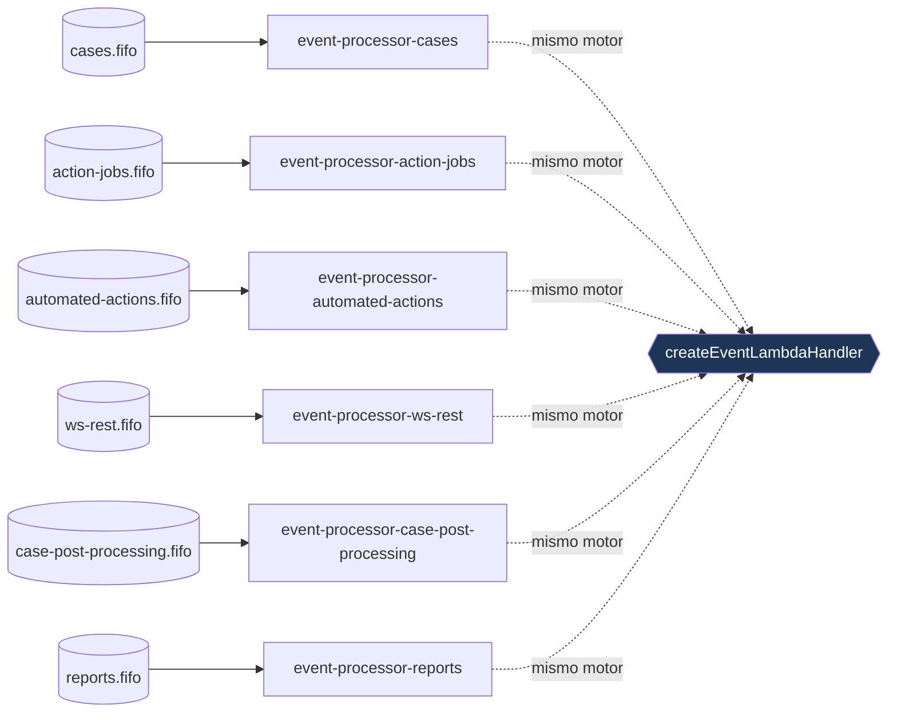

# `event-processor` — Cómo funciona el consumidor de eventos

> Complemento de [`EVENTS_FLOW_DIAGRAM.md`](./EVENTS_FLOW_DIAGRAM.md) (productores + routing a las colas)
> y de [`WORKER_JOBS.md`](./WORKER_JOBS.md) (el worker que produce `AutomatedActionsRequested`).
> Este documento explica el **lado consumidor**: el servicio `apps/apiv1/kace_cloud_api_event_processor`,
> que lee los eventos de dominio desde SQS FIFO y los ejecuta.
>
> Para el **procedimiento operativo de cutover** (drenado de colas, despliegue por fases, rollback) ver
> el [`RUNBOOK.md`](../../apps/apiv1/kace_cloud_api_event_processor/RUNBOOK.md) del propio servicio — aquí se documenta el *cómo funciona*, no el *cómo se opera*.

---

## 1. Resumen en una frase

El `event-processor` es **un stack CDK con 6 Lambdas**, una por *bounded context* (`cases`,
`action-jobs`, `automated-actions`, `ws-rest`, `case-post-processing`, `reports`). Cada Lambda
consume su cola SQS FIFO, y **las 6 comparten exactamente el mismo motor** (`createEventLambdaHandler`):
normalizan el lote, lo agrupan por tenant, abren contexto multi-tenant, y ejecutan cada evento
**con deduplicación idempotente**, reportando solo los mensajes fallidos a SQS para reintento parcial.



---

## 2. El motor compartido: `createEventLambdaHandler`

**Archivo:** `src/shared/createEventLambdaHandler.mjs`

Es una **factory** que recibe `{ handlerFactories, lambdaName }` y devuelve el `handler` de Lambda.
Cada uno de los 6 handlers (§4) solo aporta su `Map<eventName → factory>` y su nombre; el resto del
pipeline es idéntico.

### 2.1 Pipeline por invocación

```mermaid
flowchart TD
    A[Lambda recibe lote SQS/EventBridge] --> B[normalizeToRecords&#40;&#41;<br/>→ records&#91;&#93;]
    B --> C[groupRecordsByTenant&#40;&#41;<br/>parse JSON → DomainEvent → agrupa por tenant_id]
    C --> D{por cada tenant}
    D --> E[getTenant + buildKnexConfig poolMax=5<br/>KnexUsersRepository]
    E --> F[TenantContext.run&#40;tenant&#41;]
    F --> G{por cada evento}
    G --> H[runWithDeduplication&#40;&#41;]
    H -->|ya procesado| I[skip + métrica DedupHits]
    H -->|nuevo| J[handlerFactory&#40;eventName&#41; → handle&#40;event&#41;<br/>luego markAsProcessed]
    J -->|error| K[push messageId a batchItemFailures<br/>+ métrica HandlerErrors]
    D --> L[finally: userRepository.destroyConnection&#40;&#41;]
    L --> M[return &#123; batchItemFailures &#125;]

    style H fill:#1d3557,color:#fff
    style M fill:#2d6a4f,color:#fff
```



Pasos (con archivo):

1. **`normalizeToRecords(event)`** (`normalizeRecords.mjs`): unifica el formato de entrada.
   - Si llega `event.Records` → es un lote **SQS** (lo devuelve tal cual).
   - Si llega `event['detail-type']` + `event.detail` → es un evento **EventBridge** (lo envuelve en
     un único record con `body = JSON.stringify(detail)`).
   - Cualquier otro formato → loguea `unknown event format` y devuelve `[]`.
   > Es decir, **la misma Lambda puede invocarse desde SQS o desde EventBridge** sin cambios.
2. **`groupRecordsByTenant(records, batchItemFailures)`** (`groupByTenant.mjs`): por cada record hace
   `JSON.parse(body)` → `DomainEvent.fromJson()` → agrupa por `metadata.tenant_id`.
   - Sin `tenant_id` → **se descarta en silencio** (log debug); no se reintenta.
   - JSON inválido → se añade su `messageId` a `batchItemFailures` (irá a reintento/DLQ).
   - Agrupar por tenant permite **abrir una sola conexión Knex por tenant** y reutilizarla para todos
     sus eventos del lote.
3. **Por cada tenant:** `TenantContextManager.getTenant(tenantId)` →
   `buildKnexConfig(tenant, { poolMax: 5 })` → `new KnexUsersRepository(knexConfig)` →
   `TenantContext.run(tenant, ...)`. Si **falla la carga del tenant**, todos sus mensajes del lote van
   a `batchItemFailures` (`failed to load tenant context`).
4. **Por cada evento del tenant:** `runWithDeduplication(...)` (§2.2). Mide latencia
   (`EventProcessor.HandlerLatency`), cuenta dedup hits y, si lanza, registra
   `EventProcessor.HandlerErrors` y empuja el `messageId` a `batchItemFailures`.
5. **`finally`:** `userRepository.destroyConnection()` — la conexión Knex del tenant se cierra siempre.
6. **Retorna `{ batchItemFailures }`** (formato de *partial batch response* de SQS, §3).

### 2.2 Deduplicación idempotente: `runWithDeduplication`

**Archivo:** `src/shared/runWithDeduplication.mjs`

```
1. EventDeduplicator.isAlreadyProcessed(eventId)?  → sí → return { deduped: true }   (no ejecuta nada)
2. factory = handlerFactories.get(eventName)        → si no existe → throw (irá a fallo/DLQ)
3. await factory({ userRepository }, domainEvent)    → ejecuta la lógica del BC
4. markAsProcessed(domainEvent)                       → INSERT en event_deduplication (solo si 3 tuvo éxito)
```

- Usa `EventDeduplicator` + `KnexEventDeduplicationRepository` sobre la tabla **`event_deduplication`**
  (la conexión sale de `userRepository.connection`).
- **`markAsProcessed` ocurre solo después de que el handler tuvo éxito** → si el handler falla, NO se
  marca como procesado y el reintento de SQS lo volverá a intentar (semántica *at-least-once* + barrera
  idempotente).
- Es la **segunda línea** de dedup: la primera es el `MessageDeduplicationId = eventId` de SQS FIFO
  (ventana de 5 min). Esta tabla es **durable** y cubre reintentos/replays más allá de esa ventana.

---

## 3. Reintentos, fallos parciales y DLQ

- Los event sources se crean con **`reportBatchItemFailures: true`** (`event-processor-stack.ts:155`).
  Por eso el handler devuelve `{ batchItemFailures: [{ itemIdentifier: messageId }] }`: SQS **solo
  reintenta los mensajes fallidos**, no el lote entero. Los que no aparecen en la lista se consideran
  procesados (incluidos los `deduped` y los descartados por falta de `tenant_id`).
- Tras **3 recepciones fallidas** (`SQS_MAX_RECEIVE = 3`) el mensaje pasa a la **DLQ** FIFO del BC
  (retención **14 días**).
- El aislamiento es **por tenant y por mensaje**: un tenant cuyo contexto no carga no tumba a los
  demás; un evento que falla no impide procesar el resto del lote.

---

## 4. Las 6 Lambdas (un BC cada una)

Cada handler registra un `Map` de `EVENT_NAME → factory` y delega en el motor. La factory **arma sus
dependencias por invocación** a partir de `userRepository.connection` (la conexión Knex del tenant ya
abierta por el motor).

| Lambda (`lambdaName`) | Evento que maneja | Handler de `@kace/core` | Dependencias que arma la factory |
|---|---|---|---|
| `CasesEventProcessor` | `CaseCreated`, `CaseUpdated` | `ExecuteActionsOnCaseCreated`, `ExecuteActionsOnCaseUpdated` | `ActionExecutorFactory` + `ActionExecutionDomainService` (`KnexActionRepository`, `KnexCaseRepository`) |
| `ActionJobsEventProcessor` | `ActionJobCreated` | `ProcessJobOnActionJobCreated` | `JobQueueFactory` + `WorkflowExecutor` (resuelve `currentUser` por `metadata.user_id`) |
| `AutomatedActionsEventProcessor` | `AutomatedActionsRequested` | `ProcessActionQueueOnCronJobRequested` | `ActionQueueExecutor` (sobre `KnexActionsQueueExecutionsRepository`) |
| `WSRestEventProcessor` | `WSRestFlowExecutionRequested` | `ExecuteWSRestFlowOnExecutionRequested` | `WorkflowExecutor` (resuelve `currentUser` por `metadata.user_id`) |
| `CasePostProcessingEventProcessor` | `CasePostProcessingRequested` | `CasePostProcessingOnCaseCreated` | `KnexCaseRepository` (fake-case + relación de caso padre) |
| `ReportsEventProcessor` | `ReportExecutionRequested` | `ExecuteReportOnExecutionRequested` | `ReportCreator` + repositorio de ejecuciones de reporte |

> El `cases` mapea **dos** eventos a la misma Lambda; los demás, uno. La clave del `Map` es el
> `EVENT_NAME` estático de cada clase de evento (p. ej. `CaseCreated.EVENT_NAME`).

---

## 5. Infraestructura (stack CDK)

**Archivo:** `lib/event-processor-stack.ts` (extiende `KApiStack`). Cada BC se construye con
`buildBcInfra(idPrefix, bcKebab, profile)` a partir de un perfil:

| BC | timeout | memoria | batchSize | maxConcurrency | reserved | Alarmas de backlog |
|---|---|---|---|---|---|---|
| `cases` | 60 s | 1024 MB | 10 | 100 | 100 | — |
| `action-jobs` | 300 s | 1024 MB | 10 | 100 | 100 | — |
| `automated-actions` | 120 s | 1024 MB | 10 | 100 | 100 | — |
| `ws-rest` | 600 s | 1024 MB | **1** | **200** | **200** | **Sí** |
| `case-post-processing` | 30 s | 512 MB | 10 | 50 | 50 | — |
| `reports` | 600 s | 1024 MB | **1** | 50 | 50 | — |

Por cada BC se crean:

- **Cola FIFO principal** (`{svc}-{bc}-events-queue.fifo`): `contentBasedDeduplication: false` (la dedup
  la pone el productor con `MessageDeduplicationId = eventId`), `visibilityTimeout = timeout × 6`,
  long polling `20 s`, redrive a la DLQ tras `maxReceiveCount = 3`.
- **DLQ FIFO** (`{svc}-{bc}-events-dlq.fifo`): `contentBasedDeduplication: true`, retención **14 días**.
- **Lambda** (`NodejsFunction`, entry `src/{bc}/handler.mjs`) con `SqsEventSource`
  (`reportBatchItemFailures: true`) y permisos de DynamoDB (tenants).

### 5.1 EventBridge (sidecar de archivo)

Este stack **es dueño del bus EventBridge** (`{svc}-event-bus`) y de su **Archive** (retención
**90 días**, patrón `source: ['kace.core']`). Es el destino del *sidecar* que `RoutingEventBus`
escribe en paralelo a SQS (ver `EVENTS_FLOW_DIAGRAM.md` §1) — sirve para **replay/auditoría**, no
enruta a consumidores. Las 6 Lambdas reciben `grantPutEventsTo` sobre el bus.

### 5.2 Alarmas y dashboard

- **Por BC:** DLQ con > 5 mensajes (5 min), errores de Lambda ≥ 1, throttles > 10 (5 min),
  duración p99 > 80 % del timeout.
- **Solo `ws-rest`:** backlog > 1000 mensajes durante 15 min, y antigüedad del mensaje más viejo > 5 min.
- **EventBridge:** `FailedInvocations ≥ 1` en el bus (sidecar de archivo degradado).
- **Dashboard** `{svc}-event-processor`: invocaciones y profundidad de cola por BC, duración
  p50/p95/p99, errores+throttles, profundidad de DLQ y `RoutingEventBus.PublishLatency` p99 de los productores.

### 5.3 Métricas emitidas por el handler

| Métrica | Cuándo | Dimensiones |
|---|---|---|
| `EventProcessor.HandlerLatency` (ms) | cada evento procesado | `BC`, `EventName` |
| `EventProcessor.DedupHits` (count) | evento ya procesado (deduped) | `BC`, `EventName` |
| `EventProcessor.HandlerErrors` (count) | handler lanzó excepción | `BC`, `EventName`, `ErrorType` |

---

## 6. Referencias de código

| Componente | Ruta |
|---|---|
| Motor compartido | `src/shared/createEventLambdaHandler.mjs` |
| Normalización SQS/EventBridge | `src/shared/normalizeRecords.mjs` |
| Agrupado por tenant | `src/shared/groupByTenant.mjs` |
| Deduplicación | `src/shared/runWithDeduplication.mjs` |
| Handlers por BC | `src/{cases,action-jobs,automated-actions,ws-rest}/handler.mjs` |
| Stack (colas + Lambdas + bus + alarmas + dashboard) | `lib/event-processor-stack.ts` |
| Entrypoint CDK | `bin/event-processor.ts` |
| Deduplicador / repo | `@kace/core` → `shared/application/events/EventDeduplicator.js`, `shared/infrastructure/events/KnexEventDeduplicationRepository.js` |
| Runbook operativo (cutover/rollback) | `apps/apiv1/kace_cloud_api_event_processor/RUNBOOK.md` |
