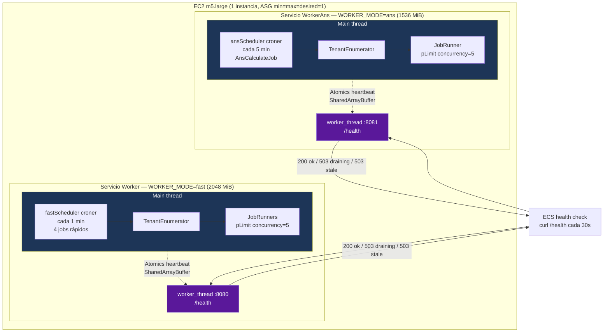
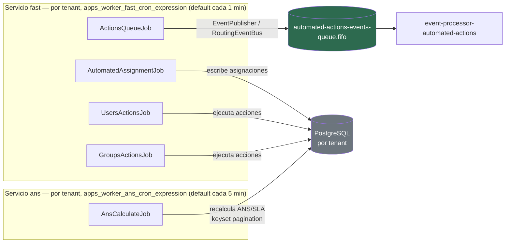
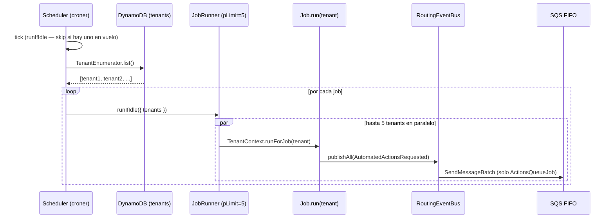
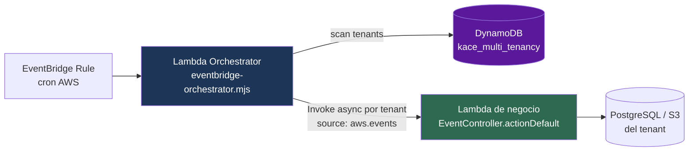
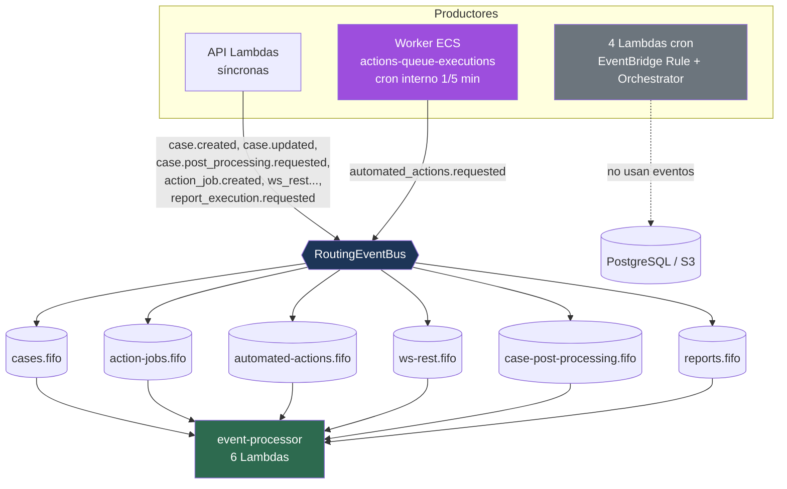

# Workers ECS y Tareas Programadas — Diagrama para Revisión con el Equipo

> Complemento de [`EVENTS_FLOW_DIAGRAM.md`](./EVENTS_FLOW_DIAGRAM.md).
> Mientras ese documento cubre el flujo *síncrono* (API → publica evento → `event-processor`),
> este cubre los **productores periódicos**: el worker ECS siempre-activo y las Lambdas disparadas por cron.

---

## 1. Panorama general

Existen **dos mecanismos** de ejecución periódica en KACE Cloud, con filosofías distintas:

| Mecanismo | Compute | Cómo se dispara | Multi-tenant | Publica eventos a SQS |
|---|---|---|---|---|
| **Worker ECS** `actions-queue-executions` | ECS EC2 (m5.large), siempre activo — **2 servicios** desde la misma imagen (`fast` + `ans`) seleccionados por `WORKER_MODE` | Cron **interno** (croner) cada 1 min (`fast`) / 5 min (`ans`) | Sí — itera tenants de DynamoDB en cada tick | **Sí** (`AutomatedActionsRequested`, solo desde el servicio `fast`) |
| **Tareas programadas** (4 Lambdas) | Lambda | **EventBridge Rule** (cron AWS) → Orchestrator | Sí — Orchestrator hace fan-out por tenant | **No** — trabajan directo contra BD/S3 |

> Punto clave para el equipo: el worker ECS es el **único productor periódico que emite eventos de dominio** hacia las colas SQS. Las 4 Lambdas cron operan directamente sobre la BD/S3, sin pasar por el bus de eventos.

---

## 2. Worker ECS: `actions-queue-executions`

**Ruta:** `apps/workers/kace_cloud_worker_actions_queue_executions/`

- **Compute:** ECS sobre EC2 (Auto Scaling Group `min=max=desired=1`, `m5.large`). Una sola instancia EC2 hospeda **dos servicios `awsvpc`** desde la **misma imagen Docker**.
- **`WORKER_MODE` (split fast/ans):** la misma imagen arranca en uno de tres modos:
  - `fast` (servicio `Worker`, puerto **8080**, `memoryReservation 2048 MiB`): corre solo los 4 jobs rápidos (cada 1 min). **Es el default fail-safe.**
  - `ans` (servicio `WorkerAns`, puerto **8081**, `memoryReservation 1536 MiB`): corre `AnsCalculateJob` y `AutomatedAssignmentBacklogJob` (crons por tenant; defaults `*/5` y `2-59/5`).
  - `all`: todos los schedulers (uso local/dev únicamente).
  > **Motivo del split** (`resolveActiveSchedulers.mjs`): la recalc SLA de `AnsCalculateJob` es síncrona y de varios minutos; aislarla en su propia task evita que congele el event loop (y el `/health`) del worker rápido y dispare reinicios de ECS. Si se congela, solo recicla su propia task `ans`.
- **Naturaleza:** servicios **siempre activos** con scheduler cron **interno** (no son scheduled tasks de ECS).
- **Health check:** `/health` (puerto 8080 en `fast`, 8081 en `ans`), ejecutado en un **`worker_thread` separado** con heartbeat vía `SharedArrayBuffer`/`Atomics` (refresco cada 5 s) — así responde aunque el main loop esté saturado por un tick pesado.

### 2.1 Arquitectura del runtime

> Ambos servicios corren la **misma imagen**; solo difieren en `WORKER_MODE`, `HEALTH_PORT` y `HEALTH_STALENESS_SECONDS`. Comparten una sola instancia EC2 (sus 2 ENIs `awsvpc` la dejan al límite a régimen, por eso el deploy es **in-place** `min=0/max=100`).

### 2.2 Los 5 jobs y qué hacen

| Job | Servicio (`WORKER_MODE`) | Frecuencia | Qué hace | ¿Publica evento? |
|---|---|---|---|---|
| `ActionsQueueJob` | `fast` | 1 min | Procesa acciones en cola; emite `AutomatedActionsRequested` | **Sí** → `automated-actions-events-queue.fifo` |
| `AutomatedAssignmentJob` | `fast` | 1 min | Asignación automática de grupos (con SQL prefilter) | No — escribe en BD |
| `UsersActionsJob` | `fast` | 1 min | Acciones CRON_JOB sobre usuarios | No — escribe en BD |
| `GroupsActionsJob` | `fast` | 1 min | Acciones CRON_JOB sobre grupos | No — escribe en BD |
| `AnsCalculateJob` | `ans` | 5 min | Recalcula ANS/SLA (~30k casos/tenant, paginación keyset) | No — UPDATE en BD |

> Solo `ActionsQueueJob` construye un `EventPublisher` (vía `buildRoutingEventBusFromTenant`); los demás escriben directo en PostgreSQL. Con el default `WORKER_MODE=fast`, el servicio rápido **nunca** instancia `AnsCalculateJob`.
>
> 📄 **Detalle por job:** ver [`WORKER_JOBS.md`](./WORKER_JOBS.md) — propósito, flujo, dependencias y salida de cada uno de los 5 jobs.

### 2.3 Ciclo de vida (tick → fan-out por tenant)

- **Protección de solape:** `runIfIdle` se salta el tick si el job anterior sigue en vuelo (`inFlight`).
- **Shutdown graceful (SIGTERM):** `/health` → 503 `draining` inmediato → schedulers dejan de aceptar ticks → `drain()` espera jobs en vuelo (hasta `max(SHUTDOWN_GRACE_SECONDS − 120, 60)`) → `process.exit(0)`. El default **desplegado vía CDK es `SHUTDOWN_GRACE_SECONDS=300`** → drain ≈ **180 s** (el default `1800` del código solo aplica si el env no se inyecta, p. ej. en local).
- **Modo stale:** si el main loop se cuelga más de `HEALTH_STALENESS_SECONDS` el heartbeat no se actualiza, `/health` → 503 `stale`, y ECS reemplaza la task tras `retries × interval` (≈150 s, con `startPeriod 120s` de gracia al boot). El umbral es **distinto por servicio:** `fast` = **300 s (5 min)**, `ans` = **1800 s (30 min)** — la ventana larga del `ans` evita matar una recalc SLA legítima de varios minutos a mitad de ejecución.

### 2.4 Variables de entorno clave

| Env Var | Default | Propósito |
|---|---|---|
| `WORKER_MODE` | `fast` | Selecciona schedulers: `fast` \| `ans` \| `all` (lo inyecta el CDK por servicio) |
| `WORKER_CONCURRENCY` | `5` | Tenants procesados en paralelo (por `JobRunner`, vía `pLimit`) |
| `SHUTDOWN_GRACE_SECONDS` | `1800` código / **`300` CDK** | Grace period para drain (`stopTimeout` del contenedor) |
| `LOCK_STALENESS_MINUTES` | `30` | Umbral del lock distribuido por tenant |
| `HEALTH_PORT` | `8080` | Puerto del `/health` (CDK: 8080 `fast`, 8081 `ans`) |
| `HEALTH_STALENESS_SECONDS` | `300` | Umbral de heartbeat stale del servicio `fast` |
| `ANS_HEALTH_STALENESS_SECONDS` | `1800` | Umbral de heartbeat stale del servicio `ans` |
| `WORKER_FAST_MEMORY_MIB` / `WORKER_ANS_MEMORY_MIB` | `2048` / `1536` | `memoryReservation` por servicio |
| `WORKER_INSTANCE_TYPE` | `m5.large` | Tipo de instancia EC2 del ASG |
| `WORKER_HEALTHCHECK_{INTERVAL,TIMEOUT,RETRIES,START_PERIOD}_SEC` | `30` / `10` / `5` / `120` | Tuning del health check de ECS |
| `DEBUG_OVERRIDE_PARAMETER_NAME` | `''` (OFF) | Parámetro SSM para toggle de log debug |
| `TARGET_DYNAMODB_TABLE` | — | Tabla multi-tenancy (lista de tenants) |
| `AWS_*_EVENTS_QUEUE_ARN` (×4) | — | ARNs de las colas (falla loud si faltan) |
| `AWS_EVENTBRIDGE_EVENT_BUS_ARN` | — | Bus de archivo EventBridge |

Los crons de los jobs no son variables de entorno: se configuran por tenant en DynamoDB
(`apps_worker_fast_cron_expression`, `apps_worker_ans_cron_expression`,
`apps_assignment_backlog_cron_expression`); ver "Schedules por tenant" en el README del worker.

**IAM del task role** (compartido por ambos servicios): `dynamodb:GetItem/Query/Scan` (tenants), `ssm:GetParameter` (toggle debug, solo si hay parámetro), `events:PutEvents` (archivo), `sqs:SendMessage` (4 colas).

---

## 3. Tareas programadas (EventBridge Rule → Orchestrator → Lambda por tenant)

Las 4 tareas comparten el mismo patrón **Orchestrator**: una EventBridge Rule con cron dispara una Lambda *orchestrator* que escanea los tenants en DynamoDB e invoca de forma **asíncrona** (`InvocationType: 'Event'`) la Lambda de negocio **una vez por tenant**.

### 3.1 Tabla de las 4 tareas

| Servicio | Schedule (cron AWS) | Función | Trabaja contra | ¿Publica evento? |
|---|---|---|---|---|
| `kace_cloud_api_ans_calculate` | `cron(*/5 * * * ? *)` — cada 5 min | Recalcula ANS/SLA de los casos (`AnsBackgroundRunner`) | PostgreSQL | No |
| `kace_cloud_api_imports_processor` | `cron(0/1 * * * ? *)` — cada min (configurable `IMPORT_CRON_EXPRESSION`) | Procesa importaciones masivas CSV desde S3, valida y persiste | PostgreSQL + S3 | No |
| `kace_cloud_api_generate_csv` | `cron(0 * * * ? *)` — cada hora | Genera/exporta vistas CSV configuradas y sube a S3 del tenant | PostgreSQL + S3 | No |
| `kace_cloud_api_partition_maintenance` | `cron(0 3 1 * ? *)` — 1.º de mes 03:00 UTC | DDL: crea particiones mensuales de `MANAGED_TABLES` (`ws_rest_flow_executions`, `event_logs`, `history_cases`, `history_usuarios`, `history_aux_cases`) | PostgreSQL (DDL) | No |

> **Lock distribuido:** `ans_calculate` e `imports_processor` usan la tabla `background_executions` para evitar ejecuciones concurrentes sobre el mismo tenant.
> **Matiz de `partition_maintenance`:** sí pasa por el orchestrator (se invoca **una vez por tenant**), pero su trabajo es *agnóstico del tenant*: itera la lista estática `MANAGED_TABLES` y ejecuta DDL idempotente (`CREATE TABLE IF NOT EXISTS ... PARTITION OF`). Resultado: las mismas particiones se (re)crean una vez por cada tenant; es inofensivo por la idempotencia, pero gasta invocaciones Lambda redundantes (candidato a invocarse una sola vez globalmente — ver §5).

### 3.2 Componentes del patrón Orchestrator

| Componente | Ruta |
|---|---|
| Orchestrator genérico | `packages/kace_cloud_api_common/src/handlers/eventbridge-orchestrator.mjs` |
| Helper CDK | `packages/kace_cloud_aws_infra/src/helpers/OrchestratorHelper.ts` |
| Detección de schedule | `handler.mjs` de cada servicio (`event.source === 'aws.events'`) → `EventController` |
| Lista de tenants | `DynamoTenantRepository.findAll()` sobre `{suffix}_kace_multi_tenancy` |

---

## 4. Vista integrada: quién alimenta las colas

---

## 5. Puntos a discutir con el equipo

1. **Doble cálculo de ANS:** sigue existiendo el job `AnsCalculateJob` (servicio ECS `ans`, cada 5 min) **y** la Lambda `kace_cloud_api_ans_calculate` (EventBridge, cada 5 min). El split `WORKER_MODE` aisló la recalc en su propia task pero **no resolvió la duplicación**: por defecto el servicio `WorkerAns` y la Lambda recalculan los mismos casos en paralelo (ambos protegidos por el lock `background_executions`, así que compiten por el lock más que duplicar UPDATEs). Conviene decidir cuál es la fuente única de verdad y desactivar el otro.
2. **Inconsistencia de transporte:** el servicio `fast` emite eventos a SQS, pero las 4 Lambdas cron operan directo contra BD/S3. ¿Se desea unificar bajo el bus de eventos, o el acceso directo es intencional por rendimiento?
3. **Single point of failure del worker:** ASG `min=max=desired=1`, y ambos servicios (`fast` + `ans`) comparten esa única instancia. Si la instancia muere hay una ventana sin procesamiento hasta el reemplazo. Además el deploy es **in-place `min=0/max=100`** (las 2 ENIs `awsvpc` saturan la m5.large), así que **cada despliegue introduce un breve gap** en ambos servicios. ¿Aceptable según SLA? (Para overlap sin downtime: instancia mayor o ENI trunking → `min=100/max=200`.)
4. **Tormenta de conexiones:** los 4 jobs rápidos × `WORKER_CONCURRENCY=5` tenants en paralelo pueden saturar el pool de Knex (ver diagnósticos previos de pool exhaustion). Revisar `poolMax` vs. concurrencia.
