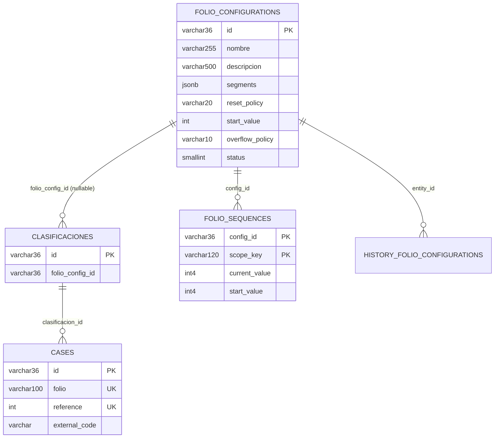
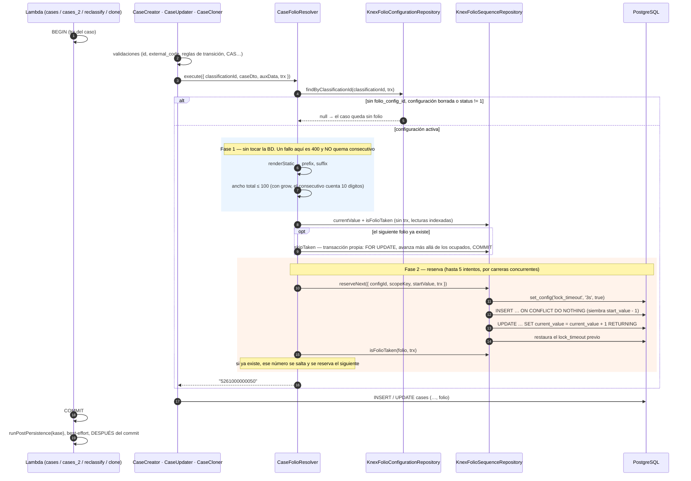

# Documentación técnica — Generador de folios / radicados

Módulo `folio-configurations`. Genera un código alfanumérico configurable por clasificación y
lo persiste en la columna `cases.folio` al crear, reclasificar o clonar un caso.

Las referencias a código usan nombres de clase y método, no números de línea.

---

## 1. Panorama y decisiones de diseño

### 1.1 Piezas del sistema

| Capa | Ruta |
| --- | --- |
| Dominio + aplicación | [`packages/kace_cloud_core/src/folio-configurations/`](../../packages/kace_cloud_core/src/folio-configurations/) |
| Vocabulario compartido (dominio, Joi y front) | [`domain/segments/segmentCatalog.js`](../../packages/kace_cloud_core/src/folio-configurations/domain/segments/segmentCatalog.js) |
| Punto de entrada desde el caso | [`cases/application/folio/CaseFolioResolver.js`](../../packages/kace_cloud_core/src/cases/application/folio/CaseFolioResolver.js) |
| Microservicio (Lambda) | [`apps/apiv1/kace_cloud_api_folio_configurations/`](../../apps/apiv1/kace_cloud_api_folio_configurations/) |
| Frontend | [`apps/kace-saas/src/pages/FolioConfigurations/`](../../apps/kace-saas/src/pages/FolioConfigurations/) |
| Migraciones | `packages/kace_cloud_database/migrations/20261006120000..20261006120005_*` |

### 1.2 Decisiones estructurales

| Decisión | Motivo |
| --- | --- |
| **Columna nueva `cases.folio`** en lugar de reutilizar `reference` | `reference` es `SERIAL` + `UNIQUE`, lo genera Postgres y está expuesto a filtros numéricos, vistas e integraciones externas. Detalle en [preguntas frecuentes → P1](preguntas-frecuentes.md#p1). |
| **Contador en tabla propia** (`folio_sequences`) y no derivado de `COUNT(*)` | Un `COUNT` seguido de `+1` es un *lost update* bajo concurrencia. Es exactamente el defecto del folio legado `countCreatedToday`. |
| **El dominio solo acepta estructuras decodificables** | Dos emisiones distintas de una misma configuración no pueden renderizar el mismo folio (§3.3). Lo que no se puede descartar estáticamente lo cubre el salto de folios ocupados (§5.4). |
| **Render en dos fases** (primero todo lo que no toca BD, después la reserva) | Una configuración rota, un auxiliar vacío o un folio demasiado ancho devuelven 400 **sin quemar consecutivo**. |
| **Reserva dentro del `trx` del caso, justo antes del INSERT** | Un rollback devuelve el número, y la fila del contador queda bloqueada solo entre la reserva y la escritura del caso. |
| **Asociación por columna en `clasificaciones`**, sin tabla pivote | La cardinalidad es 1 configuración → N clasificaciones. Se edita en un único sitio: el formulario de la clasificación. |
| **El desbordamiento nunca trunca** | Recortar dígitos produce dos casos con el mismo folio, que es justo lo que el mecanismo evita. |

### 1.3 Coexistencia con el folio legado

Existe desde antes un mecanismo distinto que decora `external_code`
([`CaseFolioGenerator`](../../packages/kace_cloud_core/src/cases/application/folio/CaseFolioGenerator.js) +
[`CaseFolioDecorator`](../../packages/kace_cloud_core/src/cases/domain/services/CaseFolioDecorator.js),
ajustes `add_folio_to_external_code` y `folio_length`). **Sigue intacto y es independiente**: un
tenant puede tener ambos activos. En `CaseCreator` el legado corre al principio sobre
`external_code` y el folio configurable al final sobre `folio`.

El legado cuenta con `countCreatedToday` (`SELECT` + `+1`, sujeto a carreras), trunca con
`.slice(-folioLength)` y escribe en `external_code`. El nuevo reserva atómicamente, nunca trunca y
escribe en `folio`.

---

## 2. Modelo de datos



### 2.1 `folio_configurations` — `20261006120000_create_folio_configurations_table.js`

Columnas neutras (Guía A §6.4): sin `NOT NULL` ni `DEFAULT` salvo la PK. Obligatoriedad, rangos y
valores por defecto los aplica el agregado `FolioConfiguration` antes de escribir.

| Columna | Tipo | Nota |
| --- | --- | --- |
| `id` | `varchar(36)` PK | UUID |
| `nombre` | `varchar(255)` | Obligatorio, 3-255 caracteres. Único **por aplicación** (`UniquenessValidator`), no por índice |
| `descripcion` | `varchar(500)` NULL | |
| `segments` | `jsonb` | Obligatorio. Lista ordenada de `{ type, ...params }` |
| `reset_policy` | `varchar(20)` | `never \| yearly \| monthly \| daily \| prefix`; `'never'` por defecto en el agregado |
| `start_value` | `integer` | 0 a 2.147.483.647 y debe caber en el ancho del consecutivo; `1` por defecto en el agregado |
| `overflow_policy` | `varchar(10)` | `fail \| grow`; `'fail'` por defecto en el agregado |
| `status` | `smallint` | `2` (inactiva) desactiva la generación |
| Auditoría | `created_at/by`, `updated_at/by`, `deleted_at/by` | Borrado lógico |

`history_folio_configurations` (`…120001_*`) sigue la convención de historial del repo
(`entity_id`, `changed_attributes`, `new_attributes`, `original_attributes`), consumida por
`KnexRepository.saveHistory`. PostgreSQL devuelve `jsonb` ya parseado, así que `segments` no
necesita conversión al leer; al escribir, el repositorio lo serializa con `JSON.stringify`.
`entity_id` está indexado (`idx_history_folio_configurations_entity_id`, `20261023120000_*`):
`findCompetingLayouts` lee ese historial al guardar cualquier configuración.

### 2.2 `folio_sequences` — la tabla de contadores (`…120002_*`)

| Columna | Tipo | Nota |
| --- | --- | --- |
| `config_id` | `varchar(36)` | PK compuesta |
| `scope_key` | `varchar(120)` | PK compuesta. `''` cuando el contador nunca reinicia |
| `current_value` | `integer` (int4) | Último número entregado |
| `start_value` | `integer` | Primer número que el contador debía entregar |

**Una fila por par (configuración, ámbito de reinicio).** La PK compuesta es a la vez el índice de
búsqueda y el destino del `ON CONFLICT` de la siembra idempotente.

- **`current_value` es `int4` a propósito**: el driver `pg` devuelve `bigint` como *string*, lo
  que rompería el `padStart`. Por eso el consecutivo admite como máximo 9 dígitos.
- **Sin `FOREIGN KEY`** hacia `folio_configurations`: la integridad referencial es de aplicación.
- **Los contadores no se borran** cuando se elimina una configuración: son la memoria de qué
  números ya se entregaron.

### 2.3 `clasificaciones.folio_config_id` (`…120003_*`)

`varchar(36)` NULL, sin FK. Una clasificación sin configuración sigue generando casos con folio
`NULL`. El controller de clasificaciones comprueba en create y en update que el id apunte a una
configuración existente y no borrada (`#ensureFolioConfigRelationship`). El setter de
`Classification.folio_config_id` normaliza `''` a `NULL`. Indexado por
`idx_clasificaciones_folio_config_id` (`20261023120000_*`), que sirve al listado de clasificaciones
asociadas y a la comprobación del Deleter.

### 2.4 `cases.folio` y su índice único parcial

`…120004_add_folio_to_cases.js` añade `folio varchar(100) NULL` y recrea las vistas como
`view_casosV7` / `view_cases_details_v10`. Su única diferencia con V6 / v9 es la línea
`cases.folio`. El `down` restaura V6 / v9.

`…120005_add_unique_index_cases_folio.js`:

```sql
CREATE UNIQUE INDEX CONCURRENTLY IF NOT EXISTS idx_cases_folio_unique
ON cases (folio)
WHERE folio IS NOT NULL
```

- El predicado **omite deliberadamente `deleted_at IS NULL`**: un folio es un identificador legal
  y un caso borrado lógicamente sigue ocupando su número.
- `CONCURRENTLY` exige correr fuera de transacción (`export const config = { transaction: false }`).
- Antes de crearlo, una sonda sobre `pg_index` filtrada por `current_schema()` (los nombres de
  índice se repiten entre los esquemas de tenant) elimina con `DROP INDEX CONCURRENTLY` el índice
  del esquema que se migra si quedó `INVALID` por una ejecución interrumpida. Se fija
  `SET statement_timeout = 0` para que una construcción larga no aborte.

---

## 3. Segmentos y reglas de la configuración

### 3.1 Catálogo de segmentos

El vocabulario vive en
[`segmentCatalog.js`](../../packages/kace_cloud_core/src/folio-configurations/domain/segments/segmentCatalog.js),
un archivo sin imports que consumen el dominio, el Joi del microservicio y el frontend. No hay
copias que mantener sincronizadas.

| Tipo | Parámetros | Render |
| --- | --- | --- |
| `literal` | `value`: texto no vacío (máx. 50 en el Joi) | El texto tal cual |
| `date` | `format` de la lista blanca | `dayjs()` en la zona horaria del tenant |
| `field` | `path` con prefijo de entidad (`aux_cases.<form>.<grupo>.<campo>`, `cases.<col>`, `clasificaciones.<col>`) | `RuleValidator.getFieldValue(path, context)` |
| `sequence` | `length` 1..9; `pad_char` de 1 carácter, def. `'0'`, nunca un dígito 1-9 | Número reservado, con `padStart(length, pad_char)` |

Hay exactamente un `sequence` por configuración, y de 1 a 20 segmentos en total.

**Formatos de fecha** (lista blanca cerrada, 14):

```
YYYY  YY  MM  M  DD  D  YYYYMM  YYMM  YYYYMMDD  YYMMDD  MMDD  HH  mm  ss
```

Un formato libre permitiría colar literales entrecomillados y cambiar el ancho del folio. `Q`,
`DDD` y `WW` se retiraron porque `DayjsFactory` solo carga los plugins `utc` y `timezone`, y sin
otros plugins esos tokens salían como `"Q"`, `"1414"` y `"WW"`. `M` y `D` son de **ancho
variable** (no rellenan con cero), lo que importa para las reglas de §3.3.

### 3.2 Rutas permitidas

- Solo raíces que el contexto de creación tiene pobladas: `RESOLVABLE_ROOTS = ['cases', 'aux_cases', 'clasificaciones']`.
  `clients.*`, `aux_clients.*` y `estados.*` se rechazan al guardar.
- `UNRESOLVABLE_PATHS = ['clasificaciones.description', 'cases.estadoActual']`.
  `RuleValidator.getFieldValue` las reescribe a `clasificaciones.id` y `estados.id`. En una regla de
  acción da igual, porque solo compara, pero un folio **renderiza** el valor: la primera embebería
  un UUID y la segunda resuelve contra `estados`, que el contexto deja vacío.
- `cases.*` resuelve contra el **payload validado** del caso. Columnas que asigna la base en el
  INSERT (por ejemplo `cases.reference`) todavía no existen y producen un 400.

### 3.3 Reglas de unicidad — `FolioUniquenessPolicy`

Garantizan que, para cualquier configuración aceptada, dos pares distintos (ámbito del contador,
número) nunca rendericen el mismo folio. Se comprueban en `FolioConfiguration.#assertInvariants`,
que llaman tanto el constructor como `update()`. Un segmento es **de ancho fijo** si es un
`literal`, un `date` con formato distinto de `M`/`D`, o el `sequence` con `overflow_policy: 'fail'`.

| Regla | Por qué |
| --- | --- |
| **A.** A uno de los dos lados del consecutivo solo puede haber segmentos de ancho fijo (o nada). | Con un campo variable a cada lado, `X12-` + 34 + `-56` se lee igual que `X` + 12 + `-34-56`. |
| **B.** Con `overflow_policy: 'grow'`, el otro lado también debe ser de ancho fijo, o empezar (junto al consecutivo) por un literal cuyo carácter adyacente no sea un dígito ni el `pad_char`. | Al crecer, el consecutivo se mezcla con un campo pegado: 100 + `5` y 10 + `05` dan los dos `1005`. |
| **C.** `yearly` exige año, `monthly` año y mes, `daily` año, mes y día, en segmentos de fecha **de ancho fijo** sin campos entre ellos y un extremo del folio. | El reinicio vuelve a emitir los mismos números; sin la fecha en una posición determinable, `RAD-0001` se repetiría cada 1 de enero. |
| **D.** `pad_char` no puede ser un dígito del 1 al 9. | Con `'9'` y ancho 4, el 5 y el 9995 se renderizan los dos como `9995`. |

`FolioUniquenessUnit.test.js` lo verifica de forma exhaustiva: para cada configuración aceptada,
renderiza todas las combinaciones de fecha, número y valores de campo de una muestra, y comprueba
que no haya colisiones. Para cada configuración rechazada demuestra que la colisión existe de
verdad.

**Entre configuraciones**, `FolioConfigurationLayoutGuard` rechaza una configuración activa que
pueda renderizar un folio que otra también renderiza (`FolioUniquenessPolicy.overlaps`). Se evalúa
al crear y al editar cuando cambian `segments`, `status` u `overflow_policy` (con `grow` el
consecutivo puede ensancharse hasta alcanzar otra estructura). Cada estructura se expande a cadenas de clases de carácter, una por cada ancho posible:

- un literal es él mismo;
- una fecha es un dígito por carácter (`M` y `D`, uno o dos);
- el consecutivo es dígito o `pad_char` por posición, con anchos de `length` a 10 si es `grow`.

Dos estructuras se solapan si dos de esas cadenas tienen la misma longitud y comparten carácter en
cada posición. Así caen `RAD-` + 4 dígitos frente a `RAD-0` + 3, o `YYYY-` frente al literal
`2026-`.

Se compara contra las configuraciones activas **y contra todas las que ya emitieron**, estén
desactivadas o borradas (las que tienen filas en `folio_sequences`). De estas se usa también el
consecutivo más estrecho con el que emitieron: `KnexFolioConfigurationRepository.findCompetingLayouts`
lo saca del historial escrito desde su primer contador. Tras emitir solo se permite ensanchar
(§8.1), así que ese ancho es lo único que puede haber cambiado.

Con campos, la comparación es por estructura enmascarada y solo detecta las idénticas. El resto lo
absorbe el salto confirmado de folios ocupados (§5.4).

### 3.4 Otras invariantes del agregado

- `prefix` exige al menos un segmento delante del consecutivo.
- `start_value` cabe en los dígitos del consecutivo.
- La longitud mínima estática (literales + formatos + ancho del consecutivo) no supera los 100
  caracteres de `cases.folio`.
- `descripcion` es opcional: usa `ValueObjectString` con `nullable`, porque `ValueObjectDescription`
  lanza ante cualquier valor vacío.

### 3.5 Contexto de resolución

[`FolioCaseContextBuilder`](../../packages/kace_cloud_core/src/folio-configurations/domain/FolioCaseContextBuilder.js)
devuelve las mismas seis claves que `KnexCaseRepository.getCaseContextById`
(`cases, aux_cases, clasificaciones, clients, aux_clients, estados`). Solo se pueblan las tres
primeras, porque ya están en mano al crear el caso y construir el contexto no cuesta ninguna
consulta extra.

---

## 4. Flujo de generación



### 4.1 Puntos de enganche

| Camino | Dónde | Comportamiento | Test |
| --- | --- | --- | --- |
| Creación | `CaseCreator.execute` y `CaseCreator2.execute`, con `config.folioResolver` | Último paso antes de `repository.save`: después de comprobar el id, el `external_code` y las reglas de transición. | `CaseFolioPaths.integration.test.js` |
| Reclasificación | `CaseReclassifier` → `CaseUpdater.execute(…, { folioResolver, auxData })` | Solo si el caso no tiene folio: *un radicado nunca se regenera*. Usa la clasificación **de destino** (la que viaja en el CAS), no la que el caso abandona. | `CaseReclassifier.integration.test.js` › `folio al reclasificar` |
| Reclasificación desde la edición con auxiliar | `applyAuxiliaryReclassification({ pendingAuxData })` → `CaseReclassifier.execute(…, { pendingAuxData })` | El auxiliar se guarda **después** de reclasificar, así que el folio se genera con el `aux_cases.data` de la petición fusionado (`DeepMergeAuxiliariesData`, como `AuxCasesUpdater`) sobre el persistido, leído con `skipCache`. | `CaseReclassifier.integration.test.js` › `con un segmento del auxiliar`; `applyAuxiliaryReclassification.test.js` |
| Clonación | `CaseCloner`, 5.º argumento `folioResolver` | `Case.clone()` anula el folio del original (el índice único rechazaría la copia) y el clon recibe uno propio de su clasificación, dentro de la transacción del clon. | `CaseFolioPaths.integration.test.js`, `cloneWithAuxCases.test.mjs` |

Lambdas que construyen el resolver, todas sobre el pool que el controller ya posee para no abrir
pools extra:

- `kace_cloud_api_cases` y `kace_cloud_api_cases_2`: `actionCreate`, la creación con auxiliar y la
  reclasificación desde `POST /cases/auxiliary/{id}` (`#buildReclassifier`);
- `kace_cloud_api_case_reclassify`;
- `kace_cloud_api_case_clone`.

El `actionUpdate` genérico no cambia la clasificación (exige el permiso `CaseReclassify`), así que no
necesita el resolver.

### 4.2 Transacción y reintentos del cliente

La creación se envuelve en una transacción (`withTransaction` en `cases`,
`connection.transaction` en `cases_2`) y `runPostPersistence(kase)` se difiere a después del
commit, en modo best-effort con `try/catch`. Sin eso, un fallo en el post-procesamiento devolvería
500, el cliente reintentaría y se generaría un segundo folio para el mismo caso.

### 4.3 Manejo de errores

| Error | Código | Origen |
| --- | --- | --- |
| Segmento sin valor, folio de más de 100 caracteres, desbordamiento con `fail` | 400 | `FolioSegmentError` (extiende `ValidationFailError`). En producción el mensaje se sustituye por uno genérico; el motivo llega en `data.detail`, `data.segment_index` y `data.segment_type` (`toPublicData`) |
| Contención sobre la fila del contador más de 3 s | 409 | `55P03 lock_not_available` → `CustomError` en `reserveNext` |
| 5 folios seguidos ya ocupados | 409 | `CaseFolioResolver.execute` |
| Colisión en `idx_cases_folio_unique` (carrera entre configuraciones) | 400 | `23505` → `KnexCaseRepository.#rethrowDuplicatedFolio`, en `save()` y vía el hook `translateWriteError` de `KnexRepository.update()` |

---

## 5. Concurrencia y unicidad

### 5.1 Incremento atómico autorreferente

```js
db(table)
    .where({ config_id: configId, scope_key: scopeKey })
    .update({ current_value: db.raw('current_value + 1'), updated_at: now })
    .returning('current_value');
```

Es una sola sentencia. Bajo `READ COMMITTED`, ese `UPDATE` mantiene un *row lock* hasta el
`COMMIT`, y una segunda transacción que choque contra él **re-evalúa `current_value + 1` sobre la
fila ya confirmada**. Da igual que sean dos Lambdas en conexiones distintas: el punto de
serialización es la fila. Leer y escribir en dos pasos sería un *lost update*, que es el defecto
del legado `countCreatedToday`.

La **siembra** `insert({ current_value: startValue - 1 }).onConflict(['config_id','scope_key']).ignore()`
hace que el primer incremento devuelva exactamente `start_value` y es inocua si otra transacción ya
creó la fila.

### 5.2 Reserva dentro de la transacción del caso

El `trx` del caso se propaga hasta `reserveNext`, así que un rollback **devuelve el número**. La
reserva es el último paso antes de escribir el caso, de modo que las creaciones concurrentes de una
misma configuración solo se serializan durante ese tramo, no durante todas las validaciones.

### 5.3 Límite de espera

`reserveNext` fija `lock_timeout = '3s'` (vía `set_config(…, true)`, local a la transacción y con
el valor como binding) **antes** de la siembra, que también puede esperar a una inserción
concurrente de la misma fila. Lo restaura tras el incremento para no imponerlo al resto de la
transacción del caso. Bajo contención sostenida se responde 409 *«El folio está en contención,
reintente la operación»* en lugar de colgarse hasta el timeout de API Gateway.

### 5.4 Folios ya ocupados y el índice único

Cubre lo que las reglas de §3.3 no pueden descartar: estructuras con campos que coinciden en algún
valor o un folio cargado a mano. Tiene dos pasos:

1. **Antes de reservar**, `CaseFolioResolver` lee el contador confirmado (`currentValue`, del
   writer y sin bloqueo) y comprueba si el siguiente folio ya existe. Solo si existe llama a
   `KnexFolioSequenceRepository.skipTaken`. Este, en una **transacción propia que se confirma**,
   bloquea la fila del contador, avanza más allá de los folios ocupados (hasta 1000 por llamada;
   la siguiente continúa) y hace `COMMIT`. Solo consume números cuyo folio ya está en otro caso,
   así que **no deja huecos visibles**, y un rollback posterior del caso no deshace el salto.
2. **Dentro del `trx`**, tras cada reserva se vuelve a comprobar con `isFolioTaken`, hasta 5
   intentos, para el folio que otra creación ocupó entretanto. Si se agotan, 409.

Antes, el salto vivía solo dentro de la transacción del caso: al agotar los intentos el rollback
devolvía los números saltados, y la creación siguiente volvía a chocar con los mismos folios.
`KnexFolioSequenceRepositoryConcurrencyIntegration.test.js` (`Salto confirmado de folios ocupados`)
lo fija con 8 folios ocupados seguidos y un rollback en medio.

Comprobar antes del INSERT evita el `23505`, que en PostgreSQL abortaría la transacción entera.
`idx_cases_folio_unique` sigue como última red ante una carrera entre dos configuraciones; en ese
caso el error es transitorio, porque el siguiente intento ya ve el folio confirmado.

### 5.5 Preview

`peek()` lee el contador sin reservar y la vista previa muestra `current + 1`. Reservar ahí quemaría
un consecutivo cada vez que un administrador abriera la pantalla.

Al editar una configuración guardada, la pantalla envía el borrador **y** su `id`: el borrador
manda en la estructura y el `id` elige el contador, así que se ve el siguiente folio real y no
`start_value` (`controllerPreview.test.mjs`, `FolioPreview.test.jsx`).

---

## 6. API

Microservicio `apps/apiv1/kace_cloud_api_folio_configurations/`, base path **`/folio-configurations`**,
puerto SAM local `60104`. `handler.mjs` elige el controller por recurso, reescribe
`event.resource` y termina siempre en `controller.run()` de `BaseController`. Así conserva la
autenticación, la lista blanca de recursos, el cierre de conexiones y la rotación de la
`session_key` de Active Directory.

| Método | Recurso | Controller → acción | Permiso |
| --- | --- | --- | --- |
| `GET` | `/` | `Controller.actionIndex` (sin paginación) | `FolioConfigurationsRead` |
| `GET` | `/{id}` | `Controller.actionRead` | `FolioConfigurationsRead` |
| `GET` | `/{id}/delete` | `Controller.actionDelete` | `FolioConfigurationsDelete` |
| `POST` | `/` | `Controller.actionCreate` → 201 | `FolioConfigurationsCreate` |
| `POST` | `/{id}` | `Controller.actionUpdate` | `FolioConfigurationsUpdate` |
| `POST` | `/search` | `Controller.actionSearch` (`SearchAuthorizationService`, clave `folio-configurations.search`) | `FolioConfigurationsRead` |
| `POST` | `/preview` | `ControllerPreview.actionCreate` | `FolioConfigurationsRead` |
| `GET` | `/{id}/classifications` | `ControllerClassifications.actionRead` (solo lectura) | `FolioConfigurationsRead` |
| `POST` | `/advance-search`, `/{id}/history` | `FolioBaseController` responde **404** | — |

`setDefaultResources` sigue montando `/advance-search` y `/{id}/history` en API Gateway. Las
acciones heredadas de `BaseController` piden `users:UsersRead` y ejecutan una búsqueda libre que no
pasa por la política `folio-configurations.search`, así que el servicio las cierra.
`routePermissions.test.mjs` recorre todas las rutas montadas y comprueba que cada una exige un
permiso del módulo o responde 404.

`FolioBaseController` comparte los dos repositorios, el cierre de sus dos pools y el mapeo de
errores. Un error de dominio responde con **su propio** `statusCode` (404 id inexistente, 409
contención, 400 configuración inválida) y lleva el mensaje en `publicData.detail`. En producción,
`Response` sustituye el mensaje de los 4xx por uno genérico, y el detalle llega en `data.detail`.

### 6.1 Ejemplo — crear una configuración

```http
POST /folio-configurations
```

```json
{
    "id": "11111111-1111-4111-8111-111111111111",
    "nombre": "Radicado PQRS",
    "descripcion": "Radicado configurable para PQRS",
    "reset_policy": "never",
    "start_value": 50,
    "overflow_policy": "fail",
    "status": 1,
    "segments": [
        { "type": "literal", "value": "5" },
        { "type": "date", "format": "YY" },
        { "type": "field", "path": "aux_cases.pqrs.datos.canal" },
        { "type": "sequence", "length": 9, "pad_char": "0" }
    ]
}
```

El Joi rechaza claves desconocidas: un segmento con `transform` o con `source` devuelve 400.

### 6.2 Ejemplo — vista previa

Acepta un `id` guardado, un borrador sin guardar o los dos (`.or('id', 'segments')`). Con los dos,
el borrador da la estructura y el `id` (404 si no existe) elige el contador:

```http
POST /folio-configurations/preview
```

```json
{
    "segments": [ /* … */ ],
    "reset_policy": "never",
    "start_value": 50,
    "overflow_policy": "fail",
    "context": {}
}
```

```json
{ "data": { "folio": "526‹canal›000000050" } }
```

Los campos sin valor se muestran como marcador `‹campo›`. El borrador se construye como un
`FolioConfiguration` efímero, que nunca se persiste, y pasa por las mismas reglas que una
configuración guardada. Su id es el de la configuración enviada o, si no hay, el fijo
`00000000-0000-4000-8000-000000000000`, sin contador.

### 6.3 Clasificaciones asociadas

`GET /folio-configurations/{id}/classifications` devuelve
`{ data: { classifications: [{ id, description }] } }`, donde `description` se compone con
`nivel1 -> nivel2 -> …`. **La asociación no se escribe aquí**: se hace desde el formulario de la
clasificación, que envía `folio_config_id`.

### 6.4 Validación (Joi, `src/schemas.mjs`)

- `segmentSchema` usa `when(type)` para impedir mezclar parámetros de tipos distintos.
- `segmentsSchema` admite de 1 a 20 segmentos y aplica la regla `exactly-one-sequence`.
- Límites: `length ≤ 9`, `start_value ≤ 2147483647`, `nombre` de 3 a 255, `literal.value ≤ 50` y
  `path` que cumpla `/^[a-zA-Z_][a-zA-Z0-9_]*(\.[a-zA-Z_][a-zA-Z0-9_]*)+$/`.
- Las reglas de §3 las aplica el dominio para cualquier llamante. El Joi es solo la frontera HTTP.

### 6.5 Infraestructura y permisos

- **CDK:** `lib/folio-configurations-stack.ts` registra los recursos estándar de `KApiStack` más
  `POST /preview` y `GET /{id}/classifications`, con `DB_TARGET` cableado.
- **Routing de BD:** `'folio-configurations': { priority: false }`. Las lecturas van a la réplica y
  las escrituras usan `DbRequestContext.markWrite()`.
- **Módulo:** `FOLIO-CONFIGURATIONS` en `ModulesEnums`.
- **Permisos:** `FolioConfigurations{Create,Update,Delete,Read}` en el rol `administrador` de
  `ListPermissions`, y sembrados al administrador base en `RolePermisionList().administrador`.
  La semilla solo alcanza a tenants nuevos: `20261022120000_grant_folio_configuration_permissions_to_admin_roles`
  los concede a los roles existentes con `access-admin:Access`, respetando cualquier valor ya
  guardado (mismo criterio que la migración de broker `20261013120000`).
  `FolioConfigurationsSearchAdvanced` está en el catálogo de búsqueda.
- **Local:** `service-manifest.mjs` expone las dos rutas personalizadas en el servidor local.

---

## 7. Frontend

```
apps/kace-saas/src/pages/FolioConfigurations/
├── index.jsx                              listado
├── FolioConfigurationUpdate.jsx           alta + edición (loader y error sin caer al alta)
├── components/
│   ├── FolioConfigurationForm.jsx         formulario (Formik + Joi)
│   ├── SegmentBuilder.jsx                 lista ordenada de segmentos
│   ├── SegmentEditor.jsx                  fila de un segmento
│   ├── FieldPathPicker.jsx                selector origen + ruta
│   ├── FolioPreview.jsx                   vista previa en vivo
│   ├── AssociatedClassifications.jsx      clasificaciones que la usan (solo lectura)
│   └── FolioConfigurationsDatatable.jsx
├── data/constants.jsx                     listas blancas (desde segmentCatalog) y defaults
├── hooks/useFolioConfigurationsActions.js permisos y acciones de la tabla
└── utils/
    ├── segments.js                        getSegmentsProblem / isSegmentComplete / isPreviewable
    └── datatableProcess.js
```

Rutas (`config/routesDictionary.js`): `/folio-configurations`, `/folio-configurations/create` y
`/folio-configurations/update/:id` (con `?action=see` para lectura). La entrada de menú está en
`routes/routes.jsx`, con el icono `Hash`, y requiere `FolioConfigurationsRead`.

### 7.1 Notas de implementación

- **`SegmentBuilder`**: el orden de la lista *es* el folio. Se reordena con flechas. Cambiar el tipo
  de un segmento reemplaza el objeto por `SEGMENT_DEFAULTS[type]`, para no arrastrar parámetros que
  la API rechazaría.
- **`SegmentEditor`**: el ancho del consecutivo se limita a `MAX_SEQUENCE_LENGTH` (9) y el campo de
  relleno descarta los dígitos 1-9.
- **`FolioConfigurationForm`**: los `segments` viven en `useState` fuera de Formik y se mezclan al
  enviar. `getSegmentsProblem` bloquea el submit con un `toast.warning` si hay 0 segmentos, ≠1
  consecutivo o alguna fila incompleta. Las reglas de §3.3 las aplica el dominio, y la vista previa
  muestra su mensaje en línea.
- **`FieldPathPicker`**: dos controles encadenados (origen → ruta), alimentados por `useModelsData`,
  el mismo hook del selector de condiciones de acciones. El segmento guarda solo `path`. Oculta las
  rutas no resolubles y, si una configuración guardada usa un origen que ya no se ofrece, lo añade
  al desplegable para no vaciar el control.
- **`FolioPreview`**: payload memoizado por valor, debounce de 400 ms, cortocircuito con
  `isPreviewable()` y descarte de respuestas viejas. El error se toma de `data.detail` (producción) o
  de `message`.
- **`AssociatedClassifications`**: lista de solo lectura con estados de carga, error y vacío, para
  que un fallo de red no se lea como «ninguna la usa».
- **Formulario de Clasificaciones**: el select `folio_config_id` (`SelectByProvider`) busca, pagina
  y ordena alfabéticamente, y solo ofrece configuraciones activas (`status eq 1`).

### 7.2 El folio en la UI del caso

No reemplaza `reference`. El helper [`utils/caseCode.js`](../../apps/kace-saas/src/utils/caseCode.js)
lo usa como **respaldo** del código externo: `getCaseCode = (kase) => kase?.external_code || kase?.folio || ""`.
Lo consumen el título del caso (`AdminCasePage.jsx`) y el selector de entidad de la vista resumida
de logs. El campo llega en `CaseResponse`, `CaseViewResponse` y `CaseDataGridResponse`, y es
filtrable desde las acciones (`FieldCatalog.CASES_COLUMNS`).

### 7.3 i18n

Bloque `folioConfigurations` en `locale/es.json` y `locale/en.json` (con paridad completa), más
`navbar.folioConfigurations` y `classification.form.sectionFolioConfigTitle`.

---

## 8. Reglas de negocio en la aplicación

### 8.1 Guardas de edición — `FolioConfigurationUpdater.#ensureCountersAllow`

Con contadores vivos (la configuración ya emitió algún folio), se rechaza con 400:

- **cambiar `start_value`**: la fila del contador se siembra una sola vez y editarlo no tendría
  efecto;
- **cambiar `reset_policy`**: la numeración volvería a empezar en otra fila y repetiría radicados;
- **cambiar los segmentos**, salvo ensanchar el consecutivo con todo lo demás idéntico. El
  contador sigue desde donde va: `A-1` + 3 dígitos pasado a `A-` + 4 volvería a renderizar `A-1001`
  en n = 1001. Ensanchar es seguro porque cada folio nuevo es más largo que los emitidos.

Además, toda edición pasa por `#assertInvariants` (§3.3) y, si cambian los segmentos o el estado,
por `FolioConfigurationLayoutGuard`.

### 8.2 Borrado — `FolioConfigurationDeleter`

- Es un borrado **lógico**.
- **Se rechaza (400) si la configuración sigue asociada a clasificaciones**: esos casos dejarían de
  recibir folio en silencio.
- **No borra `folio_sequences`**, porque son la memoria de los números ya entregados.

### 8.3 Lectura en la ruta caliente

`KnexFolioConfigurationRepository.findByClassificationId` devuelve `null` (el caso se crea sin
folio) si la clasificación no tiene `folio_config_id`, si la configuración está borrada o si
`status !== 1`.

---

## 9. Tests

| Archivo | Cobertura |
| --- | --- |
| `tests/folio-configurations/FolioRendererUnit.test.js` | Ejemplo del enunciado (`5261000000050`, ancho constante), `field` recorriendo arrays, desbordamiento `fail` / `grow`, prefijo/sufijo, `ScopeKeyResolver` con el mismo reloj que la fecha, rutas reescritas, modo preview y `toPublicData` de `FolioSegmentError` |
| `tests/folio-configurations/FolioUniquenessUnit.test.js` | Las cuatro fuentes de colisión (rechazo por create y por update, más la demostración de que colisionan), comprobación exhaustiva de configuraciones aceptadas, `overlaps` entre configuraciones verificado renderizando ambas (casos b–d del review y sus vecinos que no chocan) e invariantes por create y por update (int4, raíces, `Q/DDD/WW`) |
| `tests/folio-configurations/CaseFolioResolverUnit.test.js` | Sonda sin bloqueo, salto confirmado de una racha más larga que los intentos, render que devuelve `null` al desbordar, salto dentro del `trx`, 409 al agotar intentos y ancho máximo sin reservar, también con el crecimiento de `grow` |
| `tests/folio-configurations/FolioConfigurationIntegration.test.js` | CRUD, borrado rechazado con clasificaciones, clasificaciones asociadas, estructuras que se solapan (activa, desactivada o borrada que ya emitió, ancho recordado del historial y cambio de solo `overflow_policy`), edición con contadores vivos (solo ensanchar), `CaseFolioResolver` (genera e incrementa, `null` sin configuración o inactiva, falla sin consumir si falta el campo, `prefix` con contadores separados, preview que no consume) y `Case.clone` sin folio heredado |
| `tests/folio-configurations/KnexFolioSequenceRepositoryConcurrencyIntegration.test.js` | **Contra Postgres real** con pool `min:2 max:20`: 50 transacciones → 50 números distintos y contiguos, el primero es `start_value`, rollback sin huecos, contadores por `scope_key`, `peek`, 409 dentro del `lock_timeout` con la fila sin sembrar, restauración del `lock_timeout`, y salto confirmado: 8 folios ocupados seguidos y un rollback en medio no bloquean la creación |
| `tests/cases/CaseReclassifier.integration.test.js` (`folio al reclasificar`) | A→B asigna el folio de B; con configuración solo en el origen, no asigna nada ni consume su contador; con un segmento del auxiliar usa el valor de la petición, sin caché |
| `tests/cases/applyAuxiliaryReclassification.test.js` | Reenvía al reclasificador el auxiliar que la petición va a guardar |
| `tests/cases/CaseFolioPaths.integration.test.js` | Dos configuraciones con la misma estructura no bloquean la creación; el clon recibe un folio propio |
| `tests/cases/KnexCaseRepositoryFolioIntegration.test.js` | `update()` traduce la colisión de folio a `ValidationFailError` |
| `tests/role/BrokerPermissions.test.js` | Paridad de `FolioConfigurations*` entre `ListPermissions` y la semilla del administrador |
| `apps/apiv1/kace_cloud_api_folio_configurations/test/` | Joi (`schemas.test.mjs`), despacho del handler (`handler.test.mjs`), mapeo de errores, cierre de pools y 404 de las rutas heredadas (`folioBaseController.test.mjs`), permiso o 404 en cada ruta montada (`routePermissions.test.mjs`) y vista previa con el contador de la configuración (`controllerPreview.test.mjs`) |
| `packages/kace_cloud_database/tests/migrations/20261022120000_…test.js` | Concesión de `FolioConfigurations*` a los roles existentes con `access-admin:Access`, respetando valores guardados, y paridad con la semilla |
| `packages/kace_cloud_database/tests/migrations/20261023120000_…test.js` | **Contra Postgres real**: crea y retira los índices de `clasificaciones.folio_config_id` e `history_folio_configurations.entity_id` en el esquema del tenant |
| `apps/apiv1/kace_cloud_api_classifications/test/ClassificationFolioConfigGuard.test.mjs` | `folio_config_id` inexistente o borrado se rechaza en create y en update |
| `apps/apiv1/kace_cloud_api_case_clone/test/cloneWithAuxCases.test.mjs` | El clon resuelve su folio con su clasificación dentro del `trx` |
| Frontend | `FolioConfigurationForm`, `FolioConfigurationUpdate`, `AssociatedClassifications`, `FieldPathPicker`, `FolioPreview`, `SegmentBuilder`, `utils/segments`, `utils/caseCode`, `ClassificationSchema` y `FolioConfigurationSchema` |

> Los tests de concurrencia necesitan Postgres: SQLite serializa las escrituras y no reproduce la
> carrera. Con un pool de 1 las transacciones harían cola en el pool y no en la fila, y el test
> pasaría sin probar nada.

---

## 10. Limitaciones conocidas

| # | Limitación |
| --- | --- |
| 1 | Las colisiones **entre configuraciones** no se pueden descartar estáticamente cuando hay campos: la comparación enmascarada solo detecta las idénticas. El resto lo absorbe el salto confirmado de folios ocupados, que solo consume números cuyo folio ya existe. |
| 2 | `folio_configurations.nombre` no tiene índice único en BD: dos creaciones simultáneas con el mismo nombre pueden colarse. |
| 3 | `clasificaciones.folio_config_id` y `folio_sequences.config_id` no tienen FK declarada; la integridad es de aplicación. |
| 4 | El preview con `reset_policy: 'prefix'` muestra `start_value` en lugar del siguiente número real cuando algún segmento sale como marcador. |
| 5 | `actionIndex` usa `limit: 0` (sin paginación). La UI usa `POST /search`. |
| 6 | En modo lectura (`?action=see`) el formulario no propaga `disabled` al editor de segmentos: los controles se ven editables aunque no se puedan guardar. |
| 7 | `FolioPreview` hace la petición con `apiService` dentro de un `useEffect`, en lugar de un hook de TanStack Query. |
| 8 | `KnexFolioSequenceRepository.deleteByConfigId` existe pero no se invoca: el Deleter conserva los contadores a propósito. |
| 9 | Las guardas de §8.1 leen el contador por la réplica; con lag, una edición inmediatamente posterior al primer folio podría no verlo. |
| 10 | Una configuración guardada antes de estas reglas que las incumpla no se puede rehidratar (el constructor lanza). El módulo no estaba publicado; si hubiera filas así en un entorno, corregirlas por API o SQL antes de desplegar. |
| 11 | `history_folio_configurations` no se poda: crece una fila por cada edición. Su `entity_id` está indexado (`20261023120000_add_folio_lookup_indexes`), así que la lectura de `findCompetingLayouts` no depende de su tamaño. |
| 12 | El módulo de front vive en `src/pages` (generación 1) y no en `src_v2/features`. |
| 13 | No hay reintento automático ante un 409; la decisión es del llamante. |
