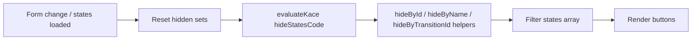

# Kace States: Ocultar botones de estado con código personalizado

## Context

El componente `kace_states` (`apps/onescript_plugin_kace/src/plugins/kace/components/states/`) renderiza:

1. **Estado actual** — botón deshabilitado (verde) con el estado en curso (`defaultState`). Siempre visible; fuera de alcance.
2. **Estados disponibles** — botones clicables por cada transición posible (`states[]`), con `state_id`, `transition_id` y `nombre`.

Hoy el `custom.form.json` es un placeholder y `index.js` no registra la pestaña Custom en el editForm. No existe forma de ocultar botones individuales según datos del formulario.

El patrón de referencia más cercano es **Attachment** (`useAttachment.js`): expresión JS reevaluada en cada `change` del formulario vía `evaluateKace`. En este caso el alcance es **por botón** (no ocultar el bloque completo) y la API es **imperativa** (funciones invocables desde el script).

Rama de trabajo: `feature/states-hide-buttons-custom-code` (desde `origin/develop`).

## Decisions

- Ocultación **dinámica**: el script se reevalúa en cada `change` del formulario y al cargar/actualizar la lista de estados.
- Alcance: **solo botones de "Estados disponibles"**. El botón de "Estado actual" no se oculta.
- Invocación: **solo desde el bloque de código personalizado** del componente Kace States (pestaña Custom). No se expone evento emitible desde otros campos (a diferencia de `kaceAttachmentVisibility`).
- Enfoque **imperativo con reevaluación completa**: en cada trigger se resetea la visibilidad (todos visibles), se ejecuta el script, y se acumulan ocultamientos vía helpers. Idempotente; sin estado residual entre ejecuciones.
- Criterios de ocultamiento: **`state_id`**, **`nombre`** y **`transition_id`**. Cada helper acepta un valor escalar o un array.
- Fail-open: si el script falla o está vacío, todos los botones permanecen visibles.
- Si el estado seleccionado queda oculto, **no** se limpia automáticamente el `transicion_id` en submission.

## Architecture



### Archivos a modificar o crear

| Archivo | Cambio |
|---|---|
| `shared/kace-events.constants.js` | `SCHEMA_KEY_STATES_HIDE_CODE = 'hideStatesCode'` |
| `states/custom.form.json` | Panel "Ocultar estados" con doc HTML + textarea Ace |
| `states/index.js` | Registrar custom tab, schema key, pasar `component` a React |
| `hooks/useStatesVisibility.js` | **Nuevo** — evaluación, sets ocultos, suscripción a `change` |
| `hooks/useStatesVisibility.test.js` | **Nuevo** — tests unitarios |
| `States.jsx` | Consumir hook y filtrar `states` antes del render |

### Schema

En `StatesComponent.schema()`:

```js
[SCHEMA_KEY_STATES_HIDE_CODE]: null,
```

### Hook `useStatesVisibility`

**Entrada:** `{ root, component, states, selected, defaultState }`

**Salida:** `{ visibleStates }`

**Triggers de reevaluación:**

1. `root.on('change')` — datos del formulario cambian.
2. `states` cambia — nueva lista de transiciones disponibles.

**Algoritmo por ejecución:**

1. Inicializar `hiddenStateIds = new Set()` y `hiddenTransitionIds = new Set()`.
2. Si `hideStatesCode` está vacío → `visibleStates = states`.
3. Construir helpers que mutan los sets:
   - `hideById(id | ids[])` — agrega `state_id`(s) al set.
   - `hideByName(name | names[])` — busca en `states` por `nombre` (trim, case-insensitive) y agrega los `state_id` coincidentes.
   - `hideByTransitionId(id | ids[])` — agrega `transition_id`(s) al set.
4. Ejecutar `evaluateKace(hideStatesCode, context)`.
5. Filtrar: excluir estado si su `state_id` está en `hiddenStateIds` **o** su `transition_id` está en `hiddenTransitionIds`.
6. Devolver `visibleStates`.

**Contexto del script (`evaluateKace`):**

| Variable | Descripción |
|---|---|
| `data` | Datos actuales del formulario (`root.data`) |
| `row` | Alias de `data` (compatibilidad Form.io) |
| `states` | Lista completa de estados disponibles |
| `selected` | `state_id` seleccionado actualmente |
| `defaultState` | Estado actual del caso |
| `hideById` | Oculta por `state_id` (escalar o array) |
| `hideByName` | Oculta por `nombre` (escalar o array) |
| `hideByTransitionId` | Oculta por `transition_id` (escalar o array) |
| `kaceEngine` | Instancia del motor Kace (si disponible) |
| `apiService` | `kaceEngine.getService('apiService')` (si disponible) |

**Reglas de matching:**

- ID / transition_id: `String(a) === String(b)`.
- Nombre: `String(nombre).trim().toLowerCase()` vs argumento normalizado igual. Homónimos → se ocultan todos.
- ID o transition inexistente en la lista actual: ignorado silenciosamente.

**Errores:** `try/catch` alrededor de `evaluateKace`; log `[States] hideStatesCode error:`; retornar todos visibles.

### Integración en `States.jsx`

```jsx
const { visibleStates } = useStatesVisibility({
  root,
  component,
  states,
  selected,
  defaultState,
});

// Renderizar visibleStates en lugar de states
```

`component` se pasa desde `index.js` en `createElement(States, { ..., component: this.component })`.

### `custom.form.json`

Panel **"Ocultar estados"** (collapsible):

- **Content HTML:** documentación de variables, helpers y ejemplo:

```javascript
if (data.tipo_caso === 'interno') {
  hideByName('Escalado');
}
if (data.prioridad === 'baja') {
  hideById([3, 7]);
  hideByTransitionId(99);
}
```

- **Textarea Ace** (`hideStatesCode`): `editor: "ace"`, `as: "javascript"`, `rows: 8`.

Nota en doc: no aplica `apiService` si el motor no está inicializado; no emite eventos a otros componentes.

## Edge Cases

| Caso | Comportamiento |
|---|---|
| Script vacío / null | Todos los botones visibles |
| Error en script | Fail-open; todos visibles; error en consola |
| Todos los botones ocultos | Mensaje existente "Sin estados disponibles" |
| Selección previa queda oculta | `transicion_id` en submission se mantiene |
| Cambio de flujo / reclasificación | Reevaluación al recibir nuevo `states[]` |
| Builder mode | Hook no ejecuta script (o no hay `root.on`) |

## Testing

Archivo: `hooks/useStatesVisibility.test.js`

| Test | Verificación |
|---|---|
| Script vacío | `visibleStates === states` |
| `hideById` escalar | Oculta un botón |
| `hideById` array | Oculta múltiples |
| `hideByName` | Case-insensitive; oculta por nombre |
| `hideByName` homónimos | Oculta todos los que coinciden |
| `hideByTransitionId` | Oculta por transition_id |
| Reevaluación | Tras cambio de `data`, botón previamente oculto vuelve a mostrarse |
| Error en script | Fail-open; todos visibles |
| ID inexistente | Sin efecto; resto visible |

## Out of Scope

- Ocultar el botón de "Estado actual".
- Evento emitible desde Custom On Change de otros campos (`emit('kaceStatesHide', ...)`).
- Configuración estática en builder (checkbox por estado).
- Ocultar el bloque completo del componente States.
