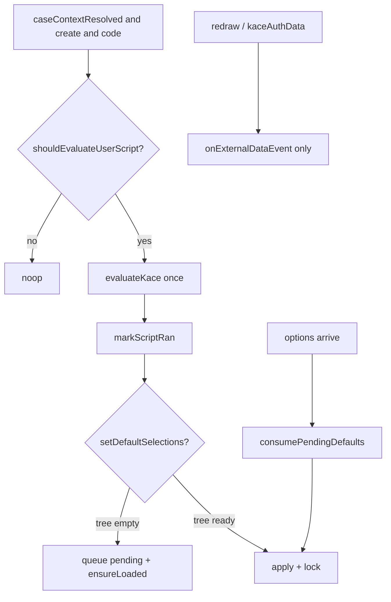

# Classifications: `classificationsInitCode` una sola vez por ciclo de vida

## Context

El componente `classification_id` (`apps/onescript_plugin_kace/src/plugins/kace/components/classifications/`) expone en la pestaña Custom el bloque **«Al cargar (solo creación de caso)»** (`classificationsInitCode`). Sirve para fijar defaults y bloqueos vía `setDefaultSelections` / `setLevelLabels` al crear un caso.

Hoy el script se re-ejecuta cuando Form.io emite `redraw` (por ejemplo al colapsar un panel) y también en `kaceAuthData` o cuando cambia `options`. Eso contradice el título del panel y provoca side-effects (logs, re-aplicación de defaults, ruido en componentes vecinos).

Causa directa en `Classifications.jsx`:

- Listener `onEvent('redraw', onRedraw)` llama `runInitScript()`.
- Listener `onEvent('kaceAuthData', onAuth)` llama `runInitScript()`.
- Un `useEffect` re-dispara `runInitScript()` al cambiar `options` / `caseContextResolved` / etc.

La documentación HTML de `custom.form.json` menciona explícitamente re-ejecución en `kaceAuthData` / `redraw`; el contrato deseado es el del título del panel (once on load en creación).

Rama de trabajo: `fix/classifications-init-code-once` (desde `origin/develop`).

## Decisions

- Contrato: el JS del usuario se evalúa **como máximo una vez** por ciclo de vida del componente React, solo en **creación de caso**.
- No re-ejecutar en `redraw` ni en `kaceAuthData`.
- No re-ejecutar cuando llega el árbol de `options`.
- Si `setDefaultSelections` se invoca sin árbol, **encolar** la intención y aplicarla al cargar opciones **sin** volver a evaluar el script.
- En edición (`isEditCase`): el script no se ejecuta (comportamiento actual).
- Si el script lanza error: se registra con `console.error` y **igual** se marca como ya ejecutado (evita loops en redraw). No reintento automático.
- Scope: **solo** `Classifications` / `classification_id`. Fuera de alcance: `ClassificationLevels`, spinner de Estados, timeout del padre al colapsar panel.
- Enfoque: módulo de dominio puro + wiring mínimo en React (TDD sobre funciones puras).
- Docs del builder alineadas al contrato (quitar mención a re-ejecución en `redraw` / `kaceAuthData`).

## Architecture



### Archivos a crear o modificar

| Archivo | Cambio |
|---|---|
| `classifications/classificationsInitPolicy.js` | **Nuevo** — sesión de init, guards, queue/consume de defaults |
| `classifications/classificationsInitPolicy.test.js` | **Nuevo** — tests vitest (TDD primero) |
| `classifications/Classifications.jsx` | Orquestar policy; quitar `runInitScript` de `redraw` / `kaceAuthData`; pending apply al llegar `options` |
| `classifications/custom.form.json` | Actualizar HTML de ayuda al contrato once + deferred defaults |

`validateSelectionAgainstTree` / `consecutiveLockedLevelCount` permanecen donde están (o se reutilizan desde el wiring al aplicar). No refactor cosmético del resto del componente.

### API del policy (`classificationsInitPolicy.js`)

Estado de sesión (inmutable por retorno; el caller guarda el valor actual en un `useRef`):

```js
{
  scriptRan: false,
  pendingDefaults: null, // Record<string, string> | null
}
```

| Función | Rol |
|---|---|
| `createInitSession()` | Estado inicial |
| `markScriptRan(session)` | Devuelve sesión con `scriptRan: true` |
| `shouldEvaluateUserScript(session, { caseContextResolved, isEditCase, code })` | `true` solo si hay código no vacío, create, contexto listo y `!scriptRan` |
| `queueOrResolveDefaults(session, selection, tree)` | Sin árbol → `{ kind: 'queue', session }`; con árbol → `{ kind: 'apply', validated, session }` (validated vía callback inyectado o selección ya validada) |
| `consumePendingDefaults(session, tree)` | Si hay pending + árbol → apply y limpia pending; si no → no-op |

Detalle de diseño para validación: el policy no acopla el árbol Form.io. `queueOrResolveDefaults` / `consumePendingDefaults` reciben `validateSelection(tree, selection) => validated` inyectado desde el caller (la función existente en `Classifications.jsx`). Así el policy es testeable con un stub y no duplica la lógica del árbol.

### Wiring en `Classifications.jsx`

1. `initSessionRef = useRef(createInitSession())`.
2. Effect de init: si `shouldEvaluateUserScript(...)`, ejecutar `evaluateKace`, luego `initSessionRef.current = markScriptRan(...)`.
3. `setDefaultSelections(obj)`:
   - `queueOrResolveDefaults(...)`.
   - `queue` → actualizar sesión + `ensureLoaded()`.
   - `apply` → `setSelectedOptions` + `setLockedLevelCount` + `persistClassificationLabels`.
4. Effect cuando `options` tiene longitud: `consumePendingDefaults` → apply si corresponde (sin `evaluateKace`).
5. Listeners:
   - `redraw` → solo `onExternalDataEvent()` (**sin** init).
   - `kaceAuthData` → solo `onExternalDataEvent()` (**sin** init).
   - `resetForm` → `resetCache` (como hoy). Si React remonta el componente, nace una sesión nueva (correcto).

### Contexto del script (`evaluateKace`)

Sin cambios de API pública: `kaceEngine`, `apiService`, `url_api`, `data`, `root`, `options`, `caseData`, `isEditCase`, `setDefaultSelections`, `setLevelLabels` (y lo ya documentado de auth si está expuesto). Solo cambia **cuántas veces** se evalúa el bloque.

## Error handling

- Fallo en `evaluateKace`: `console.error('[Classifications] classificationsInitCode error:', err)` y marcar `scriptRan` para no reintentar en cada redraw.
- Selection inválida contra el árbol: se aplica el resultado de `validateSelectionAgainstTree` (prefijo válido parcial o `{}`), igual que hoy.
- Código vacío / whitespace: no evaluar; limpiar locks/overrides como hoy cuando no hay código.

## Testing (TDD)

Orden: tests del policy (rojo) → implementar policy (verde) → wiring en `Classifications.jsx` → docs → verificación manual.

Archivo: `classificationsInitPolicy.test.js` (vitest, estilo `classificationLevelsUtils.test.js`).

Casos mínimos:

1. `shouldEvaluateUserScript` → `false` si edit / sin código / contexto no listo / `scriptRan`.
2. Primera evaluación permitida en create → tras `markScriptRan`, segunda → `false`.
3. `queueOrResolveDefaults` sin árbol → `kind: 'queue'`.
4. Con árbol → `kind: 'apply'`.
5. `consumePendingDefaults` aplica y limpia; sin pending → no-op.
6. Tras `scriptRan`, consume pending **no** implica re-evaluación del script (invariante).

No se añade test RTL del componente completo en este slice (coste/ acoplamiento Form.io + store). La política pura cubre el riesgo del bug.

### Verificación manual

Schema con `classificationsInitCode: console.log('Felipe')` + panel colapsable:

1. Al cargar el form en creación → log una vez.
2. Colapsar/expandir panel → no vuelve a loguear.
3. Script con `setDefaultSelections` cuando el árbol aún no está → defaults se aplican al cargar opciones sin segundo log del script.

## Out of scope

- `classification_levels` / `useClassificationLevelsSelect.js` (mismo anti-patrón; follow-up).
- Errores colaterales al colapsar panel (Estados en loading, «El componente padre no respondió a tiempo»).
- Cambiar la API de helpers del script.
- Refactor general de `Classifications.jsx`.

## Success criteria

- En creación, el JS de `classificationsInitCode` se evalúa como máximo una vez por mount del componente React.
- Colapsar un panel Form.io no re-ejecuta el script.
- `kaceAuthData` no re-ejecuta el script.
- Defaults diferidos (`setDefaultSelections` sin árbol) siguen funcionando sin segunda evaluación.
- Docs del builder describen el contrato once + deferred.
- Tests del policy en verde.
