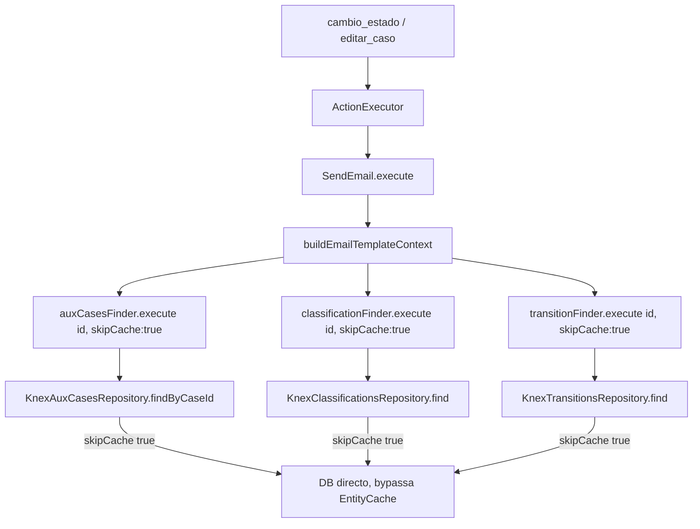

# Acciones de envío de correo: lectura fresca de aux_cases/classifications/transitions en el render del template

## Context

Existe una acción de tipo "Envío de correo" con `triggers: ["editar_caso", "cambio_estado"]` y condición `estado == "Secundario"`. El correo se envía correctamente (no falla), pero en ciertas iteraciones llega con valores **vacíos o desactualizados** en variables como `{{aux_cases.formulario_aux_felipe.apellido}}`, aunque el guardado en base de datos fue exitoso y se refleja de inmediato en la UI.

Reproducido por el usuario con evidencia (network tab + timestamps de correos reales):

1. Se crea el caso con el formulario auxiliar completo (`apellido: "Apellido equivocado"`), estado "Inicial".
2. Se actualiza `apellido` a `"Yepes"` y se transiciona a "Secundario" en el mismo guardado → correo llega **correcto** ("Apellido: Yepes").
3. Poco después, se actualiza `apellido` a `"Yepes Actualizado"` y se vuelve a transicionar a "Secundario" → correo llega **con el valor viejo** ("Apellido: Yepes", sin el "Actualizado").
4. ~5 minutos después, sin tocar `apellido`, se vuelve a cumplir la condición de la acción → correo llega **correcto** ("Apellido: Yepes Actualizado").

### Causa raíz

El envío de correo por acción corre en un worker Lambda separado del proceso API (`apps/workers/kace_cloud_worker_actions_queue_executions`), consumiendo eventos vía SQS (`RoutingEventBus`). `buildEmailTemplateContext()` (`packages/kace_cloud_core/src/shared/domain/services/emailTemplating/emailTemplatesUtils.js:19-96`) arma el contexto del template leyendo, entre otros, `aux_cases`, `clasificaciones` y `estados` a través de repositorios que usan `EntityCache` (`packages/kace_cloud_core/src/shared/infrastructure/cache/EntityCache.js`): un `Map` **en memoria del proceso**, con TTL propio por repositorio.

| Repositorio | Método cacheado | Namespace | TTL |
|---|---|---|---|
| `KnexAuxCasesRepository` (`aux_casos/infrastructure/persitance/KnexAuxCasesRepository.js:60-79`) | `findByCaseId()` | `aux_cases:byCase` | 300_000 ms |
| `KnexClassificationsRepository` (`classifications/infrastructure/persistence/KnexClassificationsRepository.js:61-80`) | `find()` | `classifications` | 60_000 ms |
| `KnexTransitionsRepository` (`transition/infrastructure/persistance/KnexTransitionsRepository.js:59-77`) | `find()` | `transitions` | 120_000 ms |

Cuando se actualiza un caso (`actionUpdateWithAux`, `apps/apiv1/kace_cloud_api_cases_2/src/controller.mjs:1018-1046`), el repositorio invalida su propia entrada de `EntityCache` tras el `update`/`save` — pero esa invalidación solo es visible **en el proceso de la API**. El worker que ejecuta la acción y renderiza el correo tiene su propia instancia de `EntityCache` (otro proceso, otro `Map`) y sigue sirviendo el valor cacheado hasta que **su propio TTL** expira. De ahí el patrón "falla en la iteración inmediata, funciona ~5 minutos después".

Verificado que **no** aplica a:
- `KnexCaseRepository.find()` (carga de la entidad `Case`/`entity`) — lectura directa, sin caché.
- `KnexStateRepository.find()` (`estados_actual`/`estados_siguiente` vía `StateFinder`) — lectura directa, sin caché.
- `EmailSender`/`EmailReplier` (otros consumidores de `buildEmailTemplateContext`) — corren en el proceso API, donde la invalidación de `EntityCache` sí es efectiva; no están afectados por este bug.

Rama de trabajo: `fix/email-action-stale-cache-cross-process` (desde `develop`).

## Decisions

- Fix puntual (no se migra `EntityCache` a un store distribuido tipo Redis; queda documentado como seguimiento si se decide una solución de raíz para los 8 repositorios que usan el mismo patrón).
- Se agrega un parámetro opcional `options` (con `skipCache`) en los 3 métodos de repositorio cacheados listados arriba. Cuando `skipCache: true`, se ejecuta la consulta directa a BD, sin pasar por `EntityCache.get(...)`.
- El parámetro se reenvía sin lógica adicional a través de los finders de dominio/aplicación intermedios (no se resuelve ni transforma en las capas intermedias).
- `buildEmailTemplateContext()` es el único call site que se modifica: sus 3 llamadas a los finders de `aux_cases`, `classifications` y `transitions` pasan `{ skipCache: true }` explícitamente, porque esta función construye el contexto de un correo disparado por un cambio real y necesita reflejarlo siempre, sin importar en qué proceso ocurrió la escritura.
- Default `skipCache: false` en los 3 repositorios preserva el comportamiento actual (cacheado) para cualquier otro consumidor existente o futuro — cero cambio de comportamiento fuera de `buildEmailTemplateContext`.
- `KnexCaseRepository` y `KnexStateRepository` no se tocan: no tienen caché que bypasear.

## Architecture

### Archivos a modificar

| Archivo | Cambio |
|---|---|
| `aux_casos/infrastructure/persitance/KnexAuxCasesRepository.js` | `findByCaseId(caseId, { skipCache = false } = {})`; si `skipCache`, ejecuta el fetcher directo |
| `aux_casos/domain/AuxCasesFinderByCase.js` | `execute(caseId, options)` reenvía `options` al repositorio |
| `aux_casos/application/find/AuxCasesFinder.js` | `execute(caseId, options)` reenvía `options` al finder de dominio |
| `classifications/infrastructure/persistence/KnexClassificationsRepository.js` | `find(id, { skipCache = false } = {})`; si `skipCache`, ejecuta el fetcher directo |
| `classifications/domain/ClassificationFinder.js` | `execute(id, options)` reenvía `options` al repositorio |
| `transition/infrastructure/persistance/KnexTransitionsRepository.js` | `find(id, { skipCache = false } = {})`; si `skipCache`, ejecuta el fetcher directo |
| `transition/domain/TransitionsFinder.js` | `execute(id, options)` reenvía `options` al repositorio |
| `shared/domain/services/emailTemplating/emailTemplatesUtils.js` | Líneas 51, 56, 66: agregar `{ skipCache: true }` a las 3 llamadas de finder |

No se crean archivos ni componentes nuevos. No se modifica `EntityCache.js`.

## Error handling

Sin cambios respecto al comportamiento actual:

- Cada método de repositorio conserva su `try/catch`/`QueryDBError` existente, sea que use la caché o no.
- El `try/catch` que ya envuelve la construcción del contexto en `buildEmailTemplateContext` (líneas 39-82) sigue tolerando fallos parciales (loguea y continúa con el campo vacío) igual que hoy — el bypass de caché no introduce una nueva rama de error.

## Testing (TDD)

Orden: test rojo → implementación → verde, repetido por repositorio.

1. **`KnexAuxCasesRepository.findByCaseId`**: con una entrada previamente cacheada (obsoleta) para un `caseId`, llamar con `{ skipCache: true }` debe devolver el valor fresco de BD; llamar sin la opción (o `{ skipCache: false }`) debe seguir devolviendo el valor cacheado (regresión — no romper el contrato de caché para otros consumidores).
2. Mismo caso para `KnexClassificationsRepository.find` y `KnexTransitionsRepository.find`.
3. **Finders intermedios** (`AuxCasesFinderByCase`, `AuxCasesFinder`, `ClassificationFinder`, `TransitionsFinder`): verificar que `options` se reenvía sin transformación al método del repositorio (spy/mock del repositorio).
4. **`buildEmailTemplateContext`**: con cachés obsoletas simuladas para `aux_cases`, `classifications` y `transitions`, el contexto devuelto refleja los valores frescos de BD en los tres campos.
5. Regresión: tests existentes de `EmailSender`/`EmailReplier` (si existen) siguen pasando sin cambios — no dependen de `skipCache`.

### Verificación manual

Reproducir la secuencia original del bug reportado (crear caso → transicionar a Secundario con cambio de apellido → transicionar de nuevo a Secundario con nuevo cambio de apellido, sin esperar) y confirmar que el segundo correo ya trae el apellido actualizado, sin esperar los ~5 minutos.

## Out of scope

- Migrar `EntityCache` a un store compartido (Redis) o agregar invalidación distribuida — aplicaría a los 8 repositorios que usan `EntityCache` (`cases`, `event-log`, `roles`, `schemas`, `ws-rest-workflow-step`, además de los 3 de este fix). Queda como seguimiento si se decide una solución de raíz.
- Cambiar el TTL de `EntityCache` o su implementación interna (`EntityCache.js`).
- Tocar `KnexCaseRepository`/`KnexStateRepository`: confirmado que no cachean, no aplica el fix.
- Cualquier cambio a `EmailSender`/`EmailReplier` más allá del que ya reciben transitivamente por `buildEmailTemplateContext` (pasan a pedir `skipCache: true` también, sin cambio de comportamiento observable ya que corren en el proceso API donde la caché ya está fresca).

## Success criteria

- Un correo disparado por `editar_caso`/`cambio_estado` refleja siempre el `aux_cases`, `clasificación` y `transición`/`estado` vigentes al momento del trigger, sin importar cuán reciente fue la escritura ni en qué proceso ocurrió.
- Ningún otro consumidor de `findByCaseId`/`find` (fuera de `buildEmailTemplateContext`) cambia de comportamiento — siguen cacheando igual que hoy.
- Tests de los 3 repositorios, sus finders y `buildEmailTemplateContext` en verde.
- Reproducción manual del bug original ya no falla.
