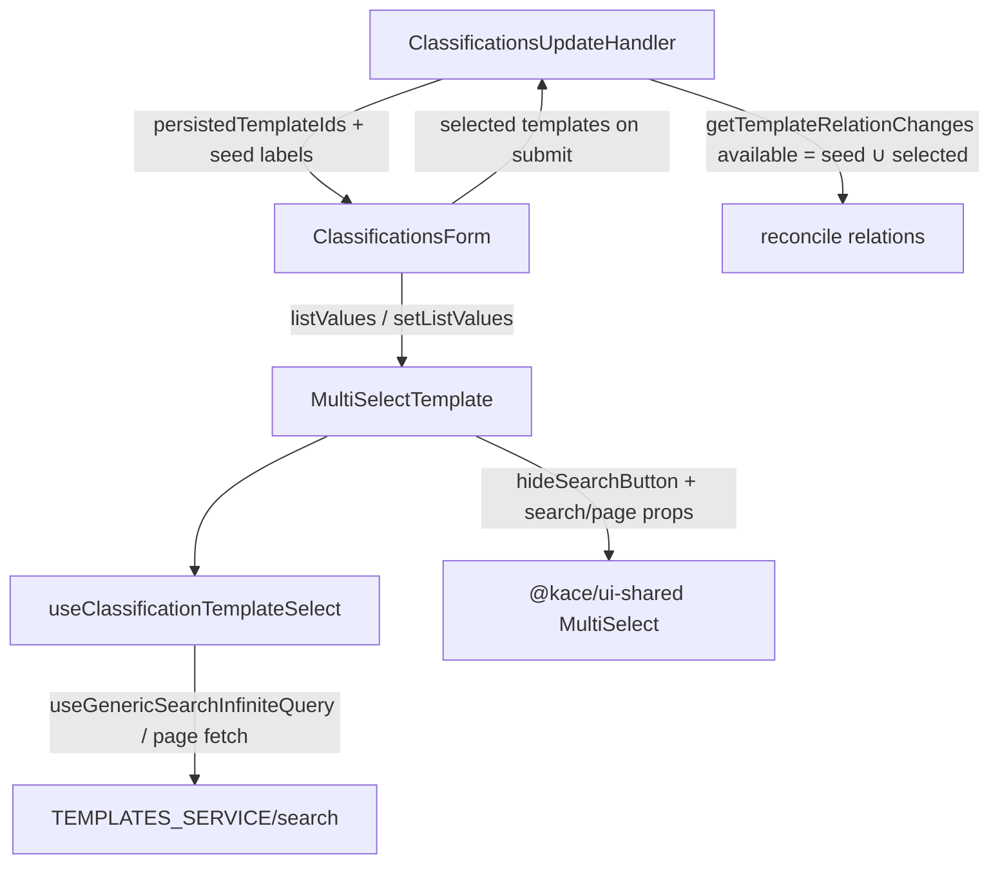

# Classifications: MultiSelectTemplate con scroll infinito, precarga, búsqueda local+API y limpieza persistente

## Context

En el formulario de Clasificaciones (`ClassificationsForm`), el selector de plantillas de email (`MultiSelectTemplate`) usa `@kace/ui-shared` `MultiSelect` de forma incompleta: no cablea búsqueda remota ni paginación, y muestra el botón morado de búsqueda (`btn_search`) que no aporta valor cuando el input ya dispara la búsqueda.

Problemas a resolver:

1. **Scroll infinito** al listar plantillas activas.
2. **Precargar** las relaciones plantilla–clasificación al editar: chips seleccionados aunque la plantilla no esté en la primera página del listado.
3. **Permitir limpiar** (quitar de a una + select/deselect all sobre lo cargado) y que el **desasociar persista** al guardar.
4. **Búsqueda dual**: filtro local inmediato sobre opciones acumuladas + búsqueda API con debounce y merge por `id`.
5. **Quitar** el botón de búsqueda del MultiSelect (`hideSearchButton`).

Hoy `ClassificationsUpdateHandler` bloquea el form hasta un dump `limit: null` de todas las plantillas activas (`templatesClassifications`) y pasa ese listado como `templateOptions`. Eso no escala y no es scroll infinito. Además `getTemplateRelationChanges` solo desasocia IDs presentes en `availableTemplateIds`; si un chip precargado no está en ese set, quitarlo en UI **no** borra la relación en backend.

Rama de trabajo: `feature/classification-multiselect-template-infinite-scroll-search` (desde `develop`).

### Fuera de alcance

- Select de flujo (`flujo_id` / `SelectByProvider` / `ClassificationFlowSelect`).
- Migrar a `@/componentsV2/core/MultiSelect`.
- Clear-all explícito (botón X en el trigger).
- Cambiar el default global de `hideSearchButton` en ui-shared para otros consumidores.
- Reutilizar o mergear la rama `feat/classifications-flow-template-selects-search` (alcance distinto: V2 MultiSelect + flujo).

## Decisions

- Base UI: seguir con `@kace/ui-shared` `MultiSelect` y `hideSearchButton={true}`.
- Orquestación: hook delgado `useClassificationTemplateSelect`; `MultiSelectTemplate` solo presenta y maneja selección.
- Búsqueda: al tipear → filtro local inmediato sobre acumulado; en paralelo debounce (~300 ms) → API `ilike` en `descripcion`; merge por `id` sin duplicar.
- Sin texto de búsqueda: browse paginado (scroll infinito).
- Precarga: al abrir el form, chips desde relaciones persistidas + labels resueltos por seed (`operator: "in"` sobre IDs persistidos). No se exige que esas plantillas aparezcan en la primera página del popover.
- Limpieza UI: chip/toggle individual + select/deselect all **solo** sobre `data` ya cargado (contrato actual del MultiSelect). Sin botón clear-all.
- Persistencia de removes: `availableTemplateIds` efectivo = `seedIds ∪ selectedIds`. Relación persistida **nunca** mostrada como chip (p. ej. plantilla inactiva fuera del seed) **se preserva** (no romper el contrato “unavailable”).
- Handler: deja de esperar el dump completo `limit: null` de plantillas activas para montar el form. Sigue cargando clasificación + relaciones; el listado browsable lo posee el hook.
- Prácticas: TDD (RED→GREEN), responsabilidades claras (SOLID), código mínimo necesario, sin refactor ajeno.

## Architecture

### Unidades

| Unidad | Responsabilidad | Depende de |
|---|---|---|
| `useClassificationTemplateSelect` | Páginas, debounce API, acumular opciones, filtro local, props para ui-shared | `useGenericSearchInfiniteQuery` (o primitivo de página equivalente), `TEMPLATES_SERVICE` |
| `MultiSelectTemplate` | Presentación + selección; `hideSearchButton` | Hook + ui-shared `MultiSelect` |
| `ClassificationsForm` | State `templates`; chips iniciales desde seed/relaciones | `MultiSelectTemplate` |
| `getTemplateRelationChanges` | Diff add/remove con semántica `available = actuables en este form` | — |
| `ClassificationsUpdateHandler` | Snapshot sin dump total; seed labels; reconcile con available ampliado | helpers + queries existentes |

### Archivos previstos

| Archivo | Cambio |
|---|---|
| `apps/kace-saas/src/pages/Classifications/hooks/useClassificationTemplateSelect.js` | Nuevo hook |
| `apps/kace-saas/src/pages/Classifications/hooks/useClassificationTemplateSelect.test.js` | Tests TDD del hook |
| `apps/kace-saas/src/pages/Classifications/components/MultiSelectTemplate.jsx` | Cablear hook + `hideSearchButton` |
| `apps/kace-saas/src/pages/Classifications/components/MultiSelectTemplate.test.jsx` | Tests del wiring |
| `apps/kace-saas/src/pages/Classifications/helpers/templateRelations.js` | Documentar / ajustar uso de `availableTemplateIds` si hace falta (firma estable) |
| `apps/kace-saas/src/pages/Classifications/helpers/templateRelations.test.js` | Casos precargado removible vs unavailable preservado |
| `apps/kace-saas/src/pages/Classifications/ClassificationsUpdateHandler.jsx` | Quitar dependencia del dump `limit: null`; seed por IDs; available = seed ∪ selected |
| `apps/kace-saas/src/pages/Classifications/components/ClassificationsForm.jsx` | Precarga de chips desde seed/relaciones (mínimo necesario) |
| Tests de form/handler existentes | Ajustes mínimos al nuevo contrato de props/seed |

No se modifica el código fuente de `@kace/ui-shared` `MultiSelect` salvo consumir props ya existentes.

## Data flow

1. **Edit mount:** handler carga clasificación + `classificationsTemplatesForm` (relaciones). Resuelve labels de `persistedTemplateIds` con search `in` (preferir activas). Snapshot: `persistedTemplateIds` + `templateSeed` (`id` + `descripcion` de cada ID resuelto). Form inicializa un chip por cada entrada del seed. IDs persistidos no resueltos en el seed **no** generan chip (quedan “unavailable” y se preservan en el diff).
2. **Browse:** hook pide página 1 (`status = 1`), acumula; al llegar al umbral de scroll pide siguiente página.
3. **Search:** input actualiza filtro local al instante; tras debounce, API `ilike` en `descripcion`. El `data` visible del MultiSelect es `uniqueById(localFilter(accumulated) ∪ apiHits)` — no se descarta lo ya cargado que siga coincidiendo localmente.
4. **Select / deselect / select-all:** mutan `listValues` en el form; select-all limitado a opciones en `data` del MultiSelect.
5. **Submit (update):** `availableTemplateIds = unique(seedIds ∪ selectedIds)`; adds = selected − persisted; removes = persisted ∩ available − selected.
6. **Submit (create):** sin cambio de contrato: `template_ids` desde la lista seleccionada.

### Contrato de búsqueda local + API

- **Local:** filtrar por label/value sobre el acumulado, síncrono con cada keystroke.
- **API:** debounce ~300 ms; filter `ilike` en `descripcion` (+ `status = 1`); al completar, `data = uniqueById(localFilter(accumulated) ∪ apiHits)`.
- **Vacío:** limpia filtro remoto y vuelve a browse paginado; chips seleccionados no se borran.

## Error handling

- Fallo de listado/búsqueda del hook: MultiSelect sin opciones / empty state; chips precargados intactos; form usable.
- Fallo de relaciones o clasificación al montar (edit): mismo gate `hasFreshFormData` / loader que hoy.
- Fallo o seed incompleto de labels: IDs no resueltos no generan chip y se preservan en el diff; el form no se bloquea.
- Reconcile parcial: conservar `TemplateRelationsPartialSaveError` + refetch + toasts actuales.
- Select-all no implica “todas las plantillas del tenant”.

## Testing (TDD)

Orden RED → GREEN:

1. **`getTemplateRelationChanges`**
   - ID en seed/selected deseleccionado → `templateIdsToRemove`.
   - Persistido no actuable (no en seed ni selected) → no remove.
   - Add de nuevo selected no persistido → `templateIdsToAdd`.

2. **`useClassificationTemplateSelect`**
   - Página 1 + hasMore; página 2 acumula sin duplicar ids.
   - Keystroke: filtro local inmediato.
   - Debounce: request API + merge por id.
   - Clear search: vuelve a browse.

3. **`MultiSelectTemplate`**
   - `hideSearchButton` activo (no `btn_search`).
   - Props de search/page cableadas al hook.
   - Select-all solo sobre data cargado (comportamiento del MultiSelect, assert de wiring).

4. **Form / handler (mínimo)**
   - Edit: chips desde relaciones sin depender de página 1 del infinite list.
   - Tras quitar chip precargado, reconcile incluye ese id en removes (unit del cálculo available o integration existente ajustada).

Sin E2E obligatorio en este alcance.

## Success criteria

- Scroll infinito funciona en el listado de plantillas del form.
- Al editar, las plantillas asociadas aparecen como chips aunque no estén en la primera página.
- Quitar chips / deselect-all sobre cargados y guardar desasocia en backend los IDs actuables; relaciones no mostradas se preservan.
- El input filtra local al instante y consulta la API con debounce + merge.
- El botón morado de búsqueda no se muestra.
- Tests nuevos/actualizados en verde; sin cambios en el select de flujo.
