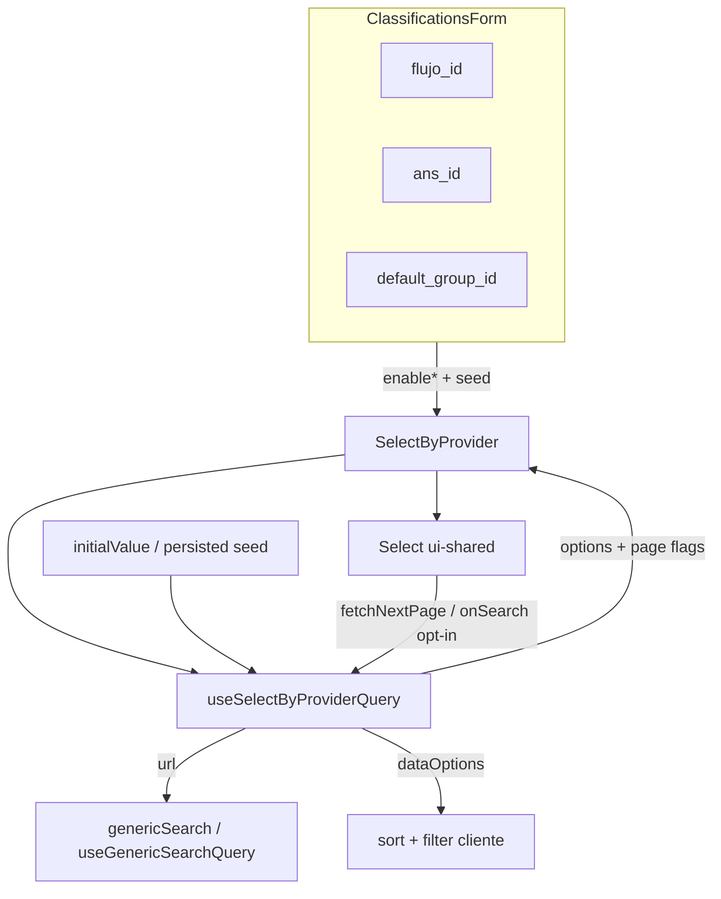

# SelectByProvider: scroll infinito, búsqueda y orden alfabético

## Context

`SelectByProvider` (`apps/kace-saas/src/components/ui-shared/src/components/SelectByProvider.jsx`) alimenta selects remotos vía `genericSearch` y se usa, entre otros, en `ClassificationsForm` para flujos (`flujo_id`), ANS (`ans_id`) y grupo por defecto (`default_group_id`).

Hoy el componente declara `page` / `queryLimit` y el `Select` de ui-shared dispara `setPage` al hacer scroll, pero `handlerOptions` **reemplaza** las opciones en cada respuesta: el scroll infinito no acumula. No hay buscador ni orden alfabético. Un valor persistido que no caiga en la primera página puede no verse en el listado hasta scrollear (si el append funcionara) o no verse nunca de forma fiable.

Existe un patrón reciente análogo en clasificaciones: `useClassificationTemplateSelect` + `useGenericSearchQuery` + MultiSelect con búsqueda remota y paginación. El Select de `src_v2` ya tiene search + infinite scroll, pero migrar Formik/ui-shared a v2 queda fuera de alcance.

Rama de trabajo: `feature/select-by-provider-infinite-scroll-search` (desde `develop`).

## Goals

- Scroll infinito que **acumula** páginas remotas (opt-in).
- Búsqueda **híbrida**: remota (`ilike`) con `url`; local sobre opciones ya cargadas / `dataOptions`.
- Orden alfabético **híbrido**: `order` en servidor con `url`; sort cliente con `dataOptions`.
- Si hay valor precargado (seed / `initialValue`), debe listarse **aunque no esté en la primera página**.
- Opt-in por props; **default = comportamiento actual** (sin romper consumidores).
- En `ClassificationsForm`, activar las tres capacidades en los tres `SelectByProvider`.
- TDD, responsabilidades claras (SOLID), código mínimo necesario.

## Non-goals

- Migrar a Select v2.
- Cambiar contratos de API backend.
- Activar flags en otros consumidores distintos de `ClassificationsForm`.
- Refactor cosmético de `SelectByProvider` no relacionado con estas capacidades.

## Decisions

| Decisión | Elección |
|----------|----------|
| Alcance | Componente compartido `SelectByProvider` + wiring en Clasificaciones |
| Activación | Opt-in (`enableSearch`, `enableInfiniteScroll`, `enableAlphabeticalOrder`) |
| Búsqueda | Híbrida: remota con `url`; local con `dataOptions` / sin remoto |
| Orden A→Z | Híbrido: `order` servidor con `url`; sort cliente con `dataOptions` |
| Seed | Unión seed ∪ páginas con dedupe; si solo hay id, resolver por `searchById` / `eq` una vez |
| Enfoque | Hook de consulta + UI Select opt-in + orquestación fina en `SelectByProvider` |
| Clasificaciones | Activar flags + seed en flujos, ANS y grupo por defecto |

## Architecture

### Units

1. **Pure helpers** (dominio mínimo, testeables sin React): unión seed∪página con dedupe; sort A→Z por label; filtro local por texto.
2. **`useSelectByProviderQuery`**: remoto (filtros base + `ilike` + `order` + acumulación + `hasNextPage` + seed-by-id) o local (`dataOptions`). Garantiza el valor seleccionado en `options`.
3. **`Select` (ui-shared)**: input de búsqueda y sentinel de scroll solo si llegan props; sin props → UI actual.
4. **`SelectByProvider`**: Formik + hook + Select; traduce props opt-in; default intacto.
5. **`ClassificationsForm`**: activa flags en los 3 selects; el valor Formik (ids en `data`) dispara la hidratación del seed en el hook.

### Files to create or modify

| Archivo | Cambio |
|---------|--------|
| `apps/kace-saas/src/components/ui-shared/src/components/selectByProvider/*.js` (o ruta mínima equivalente) | **Nuevo** — helpers puros + tests |
| `apps/kace-saas/src/hooks/useSelectByProviderQuery.js` (nombre final alineado al repo) | **Nuevo** — hook + tests |
| `.../Select/Select.jsx` (ui-shared) | UI opt-in: search + infinite scroll |
| `.../SelectByProvider.jsx` | Orquestar hook; props opt-in; acumular solo con flag |
| `.../ClassificationsForm.jsx` | Activar flags + seed en los 3 selects |
| Tests de Select / SelectByProvider / form | Contratos TDD según tareas del plan |

No tocar Select v2 ni APIs de dominio backend.

## Props contract (`SelectByProvider`)

| Prop | Default | Rol |
|------|---------|-----|
| `enableSearch` | `false` | Activa buscador (remoto si hay `url`, local si `dataOptions`) |
| `enableInfiniteScroll` | `false` | Acumula páginas; `hasNextPage` / `fetchNextPage` |
| `enableAlphabeticalOrder` | `false` | `order` servidor por campo de label, o sort cliente |
| `searchField` | derivado de `labelFrom` si es string | Campo `ilike` remoto |
| `orderField` | derivado de `labelFrom` si es string | Campo `order` remoto |
| `initialValue` | `{}` | Seed `{ id, [labelField]: label }` del valor persistido |

Props existentes (`url`, `filters`, `queryLimit`, `dataOptions`, `valueFrom`, `labelFrom`, `processData`, etc.) se mantienen.

Cuando las tres flags están en `false` y no hay cambios de wiring, el comportamiento observable debe coincidir con el actual (sin exigir paridad bit-a-bit de implementación interna).

### Hook output (mínimo)

`options`, `isLoading`, `isFetchingNextPage`, `hasNextPage`, `fetchNextPage`, y API de búsqueda (`onSearch` o `setSearch` con debounce ~300ms, alineado al Select v2 / MultiSelect).

## Seed / valor precargado

**Regla:** si Formik ya tiene un valor seleccionado, esa opción debe aparecer en `options` al montar/abrir el listado, aunque no esté en la primera página remota.

Resolución (mínima, en este orden):

1. Si `initialValue` trae id + label → unir a `options` de inmediato.
2. Si solo hay id (caso típico en Clasificaciones: `data.flujo_id` / `ans_id` / `default_group_id` sin nombre embebido) → resolver una vez el ítem por id (`searchById` / filtro `eq` vía el mismo `genericSearch`, sin dump de catálogo) y unirlo a `options`.
3. Mientras la resolución está en curso: conservar el value de Formik; el trigger puede mostrar placeholder hasta tener label.

Al acumular páginas o al buscar, deduplicar por `value` (no duplicar el seed). No ampliar el handler de Clasificaciones con joins de nombres si el fetch por id del propio select basta.

## Search and order behavior

**Remoto (`url`, sin `dataOptions`):**

- Búsqueda: filtro `ilike` sobre `searchField` (o `labelFrom` string); al cambiar el término, reset de página acumulada a 0.
- Orden: `order` ascendente sobre `orderField` (o `labelFrom` string) cuando `enableAlphabeticalOrder`.
- Scroll: append de páginas; `hasNextPage` según `total` de la respuesta o si el lote tiene longitud `queryLimit`.
- Filtros base del caller (p. ej. `status eq 1` en flujos) se conservan y se combinan con el filtro de búsqueda.

**Local (`dataOptions`):**

- Sort A→Z por label si `enableAlphabeticalOrder`.
- Filtro local por substring case-insensitive si `enableSearch`.
- Sin paginación remota.

**Sin flags:** no añadir UI de búsqueda ni acumulación; no imponer `order` nuevo.

## Errors and empty states

- Fallo de fetch de listado o de seed-by-id: conservar options ya cargadas; no introducir toast nuevo en `SelectByProvider` (hoy no lo tiene). El dropdown puede mostrar vacío / loader según estado.
- Lista vacía / búsqueda sin resultados: mensaje en el dropdown (“No hay opciones disponibles”; y “Sin resultados” si se añade prop de vacío en búsqueda).
- Mientras `isFetchingNextPage`: no disparar otra página; mostrar loader en el sentinel.

## Testing strategy (TDD)

Orden RED → GREEN → refactor:

1. **Helpers puros:** unión seed∪página + dedupe; sort A→Z; filtro local.
2. **Hook:** acumulación; `order` + `ilike` en la query; seed siempre presente; reset al cambiar search; `hasNextPage`.
3. **Select UI:** con props → input buscar + `fetchNextPage` al final; sin props → UI actual.
4. **SelectByProvider + ClassificationsForm:** flags opt-in; seed en los 3 campos.

Preferir tests enfocado (vitest) sobre el hook y helpers; UI con assertions de props/comportamiento mínimo.

## Success criteria

- Con flags en Clasificaciones: scroll acumula, búsqueda filtra, lista ordenada A→Z (remoto o local según fuente).
- Valor precargado visible sin scrollear hasta su página.
- Sin flags: consumidores existentes no cambian UX.
- Tests del contrato nuevo en verde; sin cambios de API backend.

## Open implementation notes (resolved in plan, not TBD in product)

- Nombre exacto del archivo del hook y carpeta de helpers: alinear a convenciones de `apps/kace-saas` en el plan de implementación.
- Debounce de búsqueda: ~300ms salvo que el Select/MultiSelect del repo use otro valor ya estándar.
- Si `labelFrom` es array: `searchField` / `orderField` deben pasarse explícitamente o usar el primer campo string; no adivinar concatenaciones en SQL.
