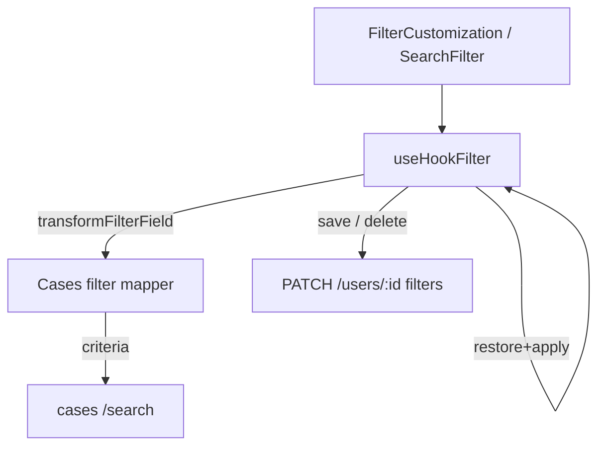

# Cases agents filters: fecha vencimiento, niveles, restore y delete

## Context

En el módulo de agentes, `CasesTableComponent` (`apps/kace-saas/src/components/core/CasesTableComponent/CasesTableComponent.jsx`) usa el modal compartido de filtros (`FilterCustomization` → `useHookFilter` → `SearchFilter`). Hay cuatro fallos / gaps:

1. **Filtro por fecha de vencimiento** — CloudWatch: `column cases.fecha_vencimiento does not exist`. El API/UI expone el alias `fecha_vencimiento`, pero la columna real es `sla_due_date`. Además `isColumnDate` en `useHookFilter` compara con igualdad exacta (`column === "fecha"`), así que `fecha_vencimiento` cae en `ilike` en lugar de `between`.
2. **Filtro por nivel de clasificación** — El UI (`SelectByListLevels`) emite `nivelN/valor` (nivel + clasificación, sin anidar). El form field sigue siendo `nivel1`, y el transformer siempre resuelve a `clasificaciones.nivel1` + hoja del path. Nivel 2–10 no filtran contra la columna correcta.
3. **Restaurar filtro guardado** — `handleSelectFilter` hace `setValue` por clave, pero no garantiza restauración correcta de todos los inputs ni aplica la búsqueda. Debe restaurar y **aplicar automáticamente**.
4. **Borrar filtros guardados** — `SearchFilter` solo lista/selecciona; no hay delete. Persistencia actual: `PATCH /users/:id` con `user.filters`.

El modal actual (`sm:max-w-[625px] max-h-[550px] overflow-auto`) obliga a scroll y trunca controles (p. ej. Classification level).

Rama de trabajo: `fix/cases-agents-filters` (desde `origin/develop`).

## Goals

- Filtrar por fecha de vencimiento contra `sla_due_date` con operador de rango (`between`).
- Filtrar por nivel elegido: valor `nivel3/Foo` → field `clasificaciones.nivel3`, value `Foo` (vista clásica).
- Al seleccionar un filtro guardado: restaurar **todos** los inputs correspondientes y aplicar la búsqueda sin toast de “¿guardar?”.
- Permitir borrar filtros guardados (icono por ítem + confirmación).
- Modal de filtros más ancho/alto y responsive; en desktop evitar scroll para el set típico de inputs de casos; en mobile, `max-h` viewport con scroll solo como último recurso.
- TDD, DDD/límites claros, SOLID, código limpio y mínimo necesario.

## Non-goals

- Anidar clasificaciones (árbol path completo); el contrato UI sigue siendo nivel + valor.
- Endpoints nuevos de filtros; se reutiliza `user.filters` vía PATCH usuario.
- Refactor de DataTable V2 / `DataTableFilterPresets`.
- Cambiar el contrato de `SelectByListLevels` (`nivelN/valor`).
- Migrar filtros de otras entidades a un sistema nuevo (solo se benefician del shared UX: modal, delete, restore+apply).
- Cambios de schema/BD o renombrar la columna `sla_due_date`.

## Decisions

| Decisión | Elección |
|----------|----------|
| Enfoque | Mappers puros (dominio casos) + orquestación en `useHookFilter` |
| Alias fecha | `fecha_vencimiento` → `sla_due_date` en el mapper de casos |
| API mapper | `resolveCasesFilterCriterion({ field, value, isCustomView }) → { field, value } \| null` (no solo `transformFilterField(name)`) |
| Operador fecha | `between` para campos fecha (incl. `fecha_*` / `data_type` date) |
| Clasificación | Parsear `nivelN/valor` → `clasificaciones.nivelN` + valor; `…/null` = incompleto (`null` criterion) |
| Vista custom | Mantener regla actual: sin prefix `clasificaciones.` cuando `isCustomView` |
| Restore | Restaurar inputs + aplicar submit; sin prompt de guardar |
| Delete UX | Icono por ítem + confirmación corta; PATCH user.filters; sin optimistic delete |
| Alcance shared | Modal, delete y restore+apply en shared; reglas de casos solo en transformers de casos |
| Persistencia | Misma estructura `filters.application.admin[view][name]` |

## Architecture

### Units

1. **Cases filter mapper (puro)** — Extiende / complementa `transformNivelFilters.js` (o helper hermano en el mismo folder):
   - API explícita (evitar ambigüedad con el `transformFilterField(fieldName)` actual, que no ve el valor):
     - `resolveCasesFilterCriterion({ field, value, isCustomView }) → { field, value } | null`
     - `null` = omitir criterio (p. ej. `nivel2/null`).
   - Field alias: form field `fecha_vencimiento` → criterion field `sla_due_date` (value de rango intacto).
   - Classification: form field puede ser `nivel1`; value `nivel3/Foo` → criterion `{ field: "clasificaciones.nivel3", value: "Foo" }` (sin prefix en custom view).
   - Wiring: `CasesTableComponent` inyecta este resolver (o un adapter delgado) en lugar de / además del `transformFilterField` solo-nombre; `useHookFilter` lo invoca con `{ field: key, value }` al armar cada criterio de casos.
   - Sin React / sin API.

2. **`useHookFilter` (orquestación)** — Usa `transformFilterField` inyectado; corrige detección de fechas; `handleSelectFilter` restaura y aplica; `handleDeleteFilter` persiste borrado.

3. **`SearchFilter`** — Lista filtros; seleccionar; borrar con confirmación por ítem.

4. **`FilterCustomization`** — Layout modal responsive más amplio; sin cambiar el contrato de inputs.

### Files to create or modify

| Archivo | Cambio |
|---------|--------|
| `apps/kace-saas/src/pages/Cases/components/CaseDataTable/utils/transformNivelFilters.js` (y/o helper hermano) | Alias `fecha_vencimiento` + resolve `nivelN/valor` → field/value |
| `…/transformNivelFilters.test.js` (o nombre alineado) | **Nuevo** — TDD mappers puros |
| `CasesTableComponent.jsx` | Inyectar transformer ampliado (si cambia la firma) |
| `useHookFilter.js` | Fechas `fecha_*`; restore+apply; delete filter |
| `useHookFilter` tests | **Nuevo/extend** — between, restore sin toast guardar, delete + rollback en error |
| `search-filter-save.jsx` (`SearchFilter`) | Botón borrar por ítem + confirmación |
| `SearchFilter` tests | **Nuevo/extend** — confirm / cancel |
| `FilterCustomization.jsx` | Modal ancho/alto/responsive |
| `FilterCustomization` tests (si aplica) | Clases / comportamiento responsive básico |

## Data flow

### Apply (submit)

1. Recorrer form; ignorar vacíos.
2. Por campo:
   - Fecha (`fecha_*` o `data_type` date/datetime): operador `between`, normalización TZ existente.
   - Clasificación (`nivelN/valor` vía transformer): field/value resueltos; omitir si incompleto.
   - `fecha_vencimiento`: field → `sla_due_date` (nunca `cases.fecha_vencimiento`).
3. Dispatch `setFilterCases` / búsqueda.
4. Toast guardar/actualizar solo en submit manual del usuario (no en restore+apply).

### Restore + apply

1. `reset` + `setValue` para cada clave del filtro guardado que exista en columnas/inputs actuales.
2. Ignorar claves huérfanas (campo ya no en schema).
3. Ejecutar el mismo pipeline de submit con esos valores, **sin** toast de guardar.
4. Resultado: inputs visibles correctos + tabla filtrada.

### Delete saved filter

1. Confirmación por ítem.
2. Si confirma: eliminar `filters.application.admin[view][name]`.
3. `PATCH /users/:id` con `{ account_type, grupo_activo, filters }`.
4. Éxito: actualizar listado local; si era el seleccionado, limpiar selección del dropdown (no forzar clear de la tabla).
5. Error: toast; el ítem permanece.

## Error handling

| Caso | Comportamiento |
|------|----------------|
| PATCH delete falla | Toast error; no quitar el ítem del listado |
| Filtro guardado con campos obsoletos | Restaurar/aplicar solo claves conocidas |
| `nivelN/null` | No enviar criterio de clasificación |
| Fecha vacía / inválida | No incluir criterio |
| Delete del filtro seleccionado | Quitar del listado y limpiar badge del dropdown |
| Mobile overflow | `max-h` viewport + scroll solo si no caben |

## Testing (TDD)

Orden: mappers → hook → SearchFilter → modal/restore casos de uso.

1. **Mappers**
   - `fecha_vencimiento` → `sla_due_date`
   - `nivel3/Foo` → `clasificaciones.nivel3` + `Foo`
   - `nivel1/Bar` → `clasificaciones.nivel1` + `Bar`
   - `nivel2/null` → incompleto / omitir
   - custom view: sin prefix `clasificaciones.`

2. **`useHookFilter`**
   - `fecha_vencimiento` usa `between`, no `ilike`
   - restore aplica submit sin toast de guardar
   - delete llama PATCH; en error el filtro sigue listado

3. **`SearchFilter`**
   - botón borrar por ítem
   - confirma antes de `onDelete`
   - cancelar no borra

4. **Modal**
   - desktop: contenedor más amplio (`max-w` / `max-h` suficientes para inputs típicos de casos)
   - mobile: respeta viewport

5. **Restore use cases (inputs)**
   Cubrir restauración de: fechas (`fecha_vencimiento`, `created_at` / `updated_at` / `fecha_resolucion`), clasificación nivel+valor, strings (`reference`, estado, nombres) y campos especiales del schema de agentes presentes en el form.

## Success criteria

- Filtrar por Fecha Vencimiento no produce error SQL; resultados coherentes con `sla_due_date`.
- Elegir Nivel 2–10 + clasificación filtra esa columna (`clasificaciones.nivelN`).
- Seleccionar filtro guardado rellena todos los inputs aplicables y aplica la búsqueda.
- Borrar filtro guardado pide confirmación, persiste y actualiza el listado.
- Modal usable sin scroll forzado en desktop típico; responsive en mobile.

## Out of scope notes

- MassiveExecution y admin CaseDataTable se benefician si reutilizan el mismo transformer/hook; no se añade UI específica fuera del shared + wiring de `CasesTableComponent`.
- No se migra el alias de respuesta API (`fecha_vencimiento` en `CaseDataGridResponse`); solo el criterio de búsqueda.
