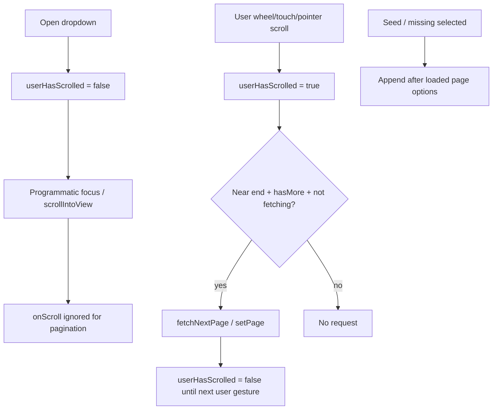

# Classifications selectors: seed al final + gate de scroll infinito

## Context

En `ClassificationsForm` conviven:

1. **`MultiSelectTemplate`** — plantillas con scroll infinito (`useClassificationTemplateSelect` + `MultiSelect`).
2. **`SelectByProvider`** (flujo, ANS, grupo) — opciones remotas con seed del valor persistido + scroll infinito (`useSelectByProviderQuery` + `Select` ui-shared).

Hoy:

- `mergeSeedIntoOptions` **antepone** el seed (`[seed, ...options]`), rompiendo el orden A→Z visual.
- Al abrir el select, Radix/cmdk **enfoca** el valor seleccionado. Si ese ítem está (o se mueve) cerca del final, el `onScroll` interpreta el enfoque como “llegué al fondo” y dispara `fetchNextPage` / `setPage` en cascada hasta cargar la página natural del registro.
- `MultiSelectTemplate` inyecta seleccionados faltantes y los **intercala** con sort A→Z; al paginar, el seleccionado se desplaza y el foco vuelve a empujar el scroll al fondo.

Rama: `fix/classifications-select-infinite-scroll-seed` (desde `develop`).

## Goals

- Si el valor seleccionado **no** está en la primera página cargada, el seed/opción faltante debe ir al **final** de la lista (no al inicio ni intercalado por A→Z).
- Al abrir y enfocar ese ítem, **no** se debe disparar paginación hasta que el usuario haga un gesto de scroll real (`wheel` / `touch` / pointer drag).
- Un scroll de usuario al final sigue cargando **una** página; no hay ráfaga automática por reflujo/enfoque.
- TDD, responsabilidades claras, código mínimo necesario.
- Sin cambios de contrato de API ni migración a Select v2.

## Non-goals

- Cambiar búsqueda, orden remoto, o flags opt-in de `SelectByProvider`.
- Auto-cargar páginas hasta encontrar el seleccionado en su posición “natural”.
- Refactors cosméticos fuera del seed + gate de scroll.
- Touch de `ClassificationsForm` salvo que un test de wiring lo exija (el bug vive en helpers/Select/MultiSelect/MultiSelectTemplate).

## Decisions

| Decisión | Elección |
|----------|----------|
| Posición del seed | **Append** al final cuando no está en opciones cargadas |
| Plantillas faltantes | Igual: datos de página A→Z; seleccionados faltantes **al final** |
| Gate de paginación | Solo tras gesto de usuario en el viewport/lista; reset al cerrar/abrir |
| Dónde vive el gate | `Select` (ui-shared Formik) y `MultiSelect` (ui-shared) |
| Helper de seed | Cambiar `mergeSeedIntoOptions` (único productor del orden del seed) |
| Cascada post-fetch | Tras disparar página, volver a exigir gesto de usuario (evita scroll sintético al crecer el DOM) |

## Architecture

### Units

1. **`mergeSeedIntoOptions`** — append + dedupe (puro).
2. **`MultiSelectTemplate` options builder** — `sort(pageData)` + append missing selected (sin re-sort conjunto).
3. **Scroll gate** — ref/flag en `Select` y `MultiSelect`: armar con gesto usuario; desarmar al open y tras cada fetch disparado.
4. **Tests** — helpers, Select scroll, MultiSelect scroll, MultiSelectTemplate orden; hook seed al final si ya hay cobertura.

### Files

| Archivo | Cambio |
|---------|--------|
| `.../selectByProvider/selectByProviderOptions.js` | Append seed |
| `.../selectByProvider/selectByProviderOptions.test.js` | Expectativa append |
| `.../Select/Select.jsx` | Gate de scroll infinito |
| `.../Select/Select.search.test.jsx` | Tests gate |
| `.../multiSelect/MultiSelect.jsx` | Gate de scroll infinito |
| Test MultiSelect (nuevo o existente) | Tests gate |
| `.../MultiSelectTemplate.jsx` | Missing selected al final |
| `.../MultiSelectTemplate.test.jsx` | Expectativa al final |
| `.../useSelectByProviderQuery.test.js` | Ajuste si asume seed al inicio |

## Behavior contracts

### Seed / missing selected

- Si el id seleccionado **ya** está en la página acumulada → no duplicar; conservar label de página.
- Si **no** está → append una sola entrada al final.
- Con término de búsqueda: se mantiene `shouldIncludeSeedInOptions` (sin seed si no matchea el filtro).

### Scroll gate

- Al abrir el dropdown: gate **cerrado**.
- Enfoque/scroll programático: **no** pagina.
- El gate se arma con: `wheel`, `touchStart`, `pointerDown`/`pointerMove` en el **Content** (cubre `SelectScrollDownButton`), y teclado `ArrowDown` / `PageDown` / `End`.
- Si el viewport ya está al fondo (seed enfocado), un `wheel` con `deltaY > 0` pagina sin exigir otro evento `scroll` (evita el up-then-down).
- Guardas (`hasNextPage` / `!isFetchingNextPage` / `hasMore`) **antes** de `consume()`, para no gastar el gesto mientras hay fetch en vuelo.
- Guard complementario por `scrollHeight` de la última página pedida: rechaza otra petición hasta que el DOM crezca.
- Tras invocar `fetchNextPage` / `setPage`: gate cerrado hasta el siguiente gesto. Un flick de trackpad puede emitir varios `wheel` y encadenar páginas cuando cada fetch termina (no hay ráfaga concurrente).

### Missing selected (plantillas)

- Página cargada ordenada A→Z; faltantes al final, también A→Z entre sí.
- Faltantes se ocultan si no matchean `searchQuery.filter` / `input` (paridad con `shouldIncludeSeedInOptions`).

### Out of scope (DRY helper)

- `FilterClassificationSelect` migra a `isViewportAtBottom` (mismo módulo Classifications).
- Quedan fuera a propósito: `SelectByUrlWithInfiniteScroll` y `src_v2/.../Select.jsx` (no usan el seed append ni el gate de este PR; migración aparte).

### Success criteria

1. Editar clasificación con flujo/ANS/grupo fuera de la 1ª página → al abrir el select, el seleccionado aparece **al final**, enfocado, **sin** ráfaga de requests.
2. Scroll / wheel / teclado / chevron al final → carga siguiente página; no cascada por focus programático.
3. Plantilla seleccionada fuera de los primeros 20 → misma regla: al final + sin cascada al abrir.
4. Tests unitarios verdes en los archivos tocados.

## Spec self-review

- Sin placeholders ni TODOs abiertos.
- No contradice el design previo de SelectByProvider (solo corrige posición del seed + gate UI).
- Alcance acotado a seed order + scroll gate; no toca API ni flags opt-in.
