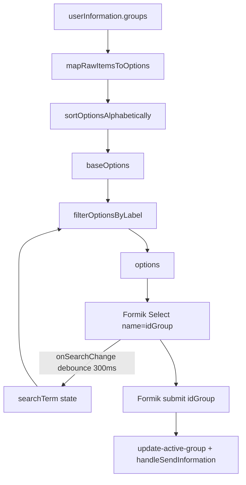

# GroupConfiguration: select de grupos con búsqueda, orden A→Z y check visible

## Context

`GroupConfiguration` (`apps/kace-saas/src/pages/GroupConfiguration/GroupConfiguration.jsx`) muestra un formulario Formik para elegir el grupo de trabajo cuando el usuario tiene más de uno. Hoy usa el Select Radix crudo de `@kace/ui-shared` y mapea `userInformation.groups` sin ordenar ni filtrar.

Problemas actuales:

1. El listado no está ordenado alfabéticamente.
2. No hay buscador; con muchos grupos es difícil encontrar uno.
3. El check del item seleccionado se solapa con el label: `SelectItem` lleva `className="p-2 …"`, que pisa el `pl-8` del componente base donde vive el indicador absoluto.

Ya existe un Select Formik compartido (`…/Select/Select.jsx`) con buscador opt-in (`onSearchChange` + `SelectContent.header`) y helpers puros en `selectByProviderOptions.js` (`mapRawItemsToOptions`, `sortOptionsAlphabetically`, `filterOptionsByLabel`) con tests.

Rama de trabajo: `feat/group-configuration-searchable-select` (desde `develop`).

## Goals

- Listar grupos en orden alfabético por `nombre` (label).
- Select con buscador que filtre en cliente sobre la lista ya cargada.
- Check del grupo seleccionado visible, sin solaparse con el texto.
- Migrar al Select Formik compartido.
- TDD, SOLID, código limpio y mínimo necesario.

## Non-goals

- Cambios de backend o contratos de API.
- Infinite scroll / remote search (la lista viene en `userInformation.groups`).
- Modificar el Select Radix base o el Select Formik salvo bug real fuera de este wiring.
- Extraer o mover helpers fuera de `selectByProviderOptions.js`.
- Preservar testids legacy `group_configuration_select_*` (se aceptan los del Select compartido).
- Clearable, i18n nueva, o cambios al flujo de submit / auto-selección de un solo grupo.

## Decisions

| Decisión | Elección |
|----------|----------|
| UI | Migrar al Select Formik (`name="idGroup"`, `onSearchChange`) |
| Orden | `sortOptionsAlphabetically` (localeCompare + `sensitivity: "base"`) |
| Filtro | `filterOptionsByLabel` — substring case-insensitive sobre `label` |
| Mapeo | `mapRawItemsToOptions` (`valueFrom: "id"`, `labelFrom: "nombre"`) |
| Helpers | Reutilizar los de `selectByProviderOptions.js` (sin duplicar) |
| Testids | Aceptar los del Select compartido |
| Check | Dejar de pasar `p-2` en items; el Select compartido ya reserva `pl-8` |

## Architecture

### Units

1. **Helpers existentes** (ya testeados): map, sort, filter — sin cambios salvo uso.
2. **Wiring en `GroupConfiguration`**: estado `searchTerm`, `useMemo` para `baseOptions` / `filteredOptions`, render del Select Formik.
3. **Select Formik compartido**: sin cambios de API; consume `options` + `onSearchChange`.

### Files to create or modify

| Archivo | Cambio |
|---------|--------|
| `apps/kace-saas/src/pages/GroupConfiguration/GroupConfiguration.jsx` | Reemplazar Select Radix crudo por Select Formik; sort/filter; quitar Label manual y `p-2` / `bg-red-400` |
| `apps/kace-saas/src/pages/GroupConfiguration/GroupConfiguration.select.test.jsx` (o nombre alineado al repo) | **Nuevo** — TDD del wiring: options ordenadas/filtradas pasadas al Select |
| `selectByProviderOptions.js` / sus tests | **Sin cambios** (reuso) |
| `Select/Select.jsx` | **Sin cambios** |

## Data flow

1. Con `groups.length === 0` o `=== 1` o `groupIdLocal`: early-returns actuales sin cambio.
2. Con varios grupos: Formik `initialValues={{ idGroup }}`, schema `GroupSelectUserSchema` intacto.
3. `baseOptions = sort(map(groups))`.
4. `filteredOptions = filter(baseOptions, searchTerm)`.
5. Select Formik: `label="Grupos"`, `placeholder="Selecciona tu grupo de trabajo"`, `id="group_configuration"`.
6. Submit: misma lógica (`update-active-group`, `handleSendInformation`, redirect).

## Error handling / edge cases

- Búsqueda vacía o solo espacios → lista completa ordenada.
- Filtro sin matches → mensaje `select.noOptions` del Select compartido.
- Validación Formik sin cambios.
- Debounce de búsqueda: responsabilidad del Select (300 ms); la página solo guarda el término emitido.

## Testing (TDD)

1. **Red**: test de wiring que, con groups desordenados, espera options ordenadas A→Z; con `searchTerm`, espera subset filtrado.
2. **Green**: implementar map/sort/filter + Select Formik en la página (mock del Select o assert de props según patrón del repo).
3. **No re-testear** helpers ya cubiertos en `selectByProviderOptions.test.js`.
4. Regresión visual/contrato: el markup no reintroduce `className` con `p-2` en items del select de grupos.

## Success criteria

- Grupos visibles en orden alfabético por nombre.
- Input de búsqueda filtra por substring case-insensitive.
- Check del item seleccionado no se solapa con el label.
- Submit y auto-flujo de un grupo / localStorage intactos.
- Código mínimo: sin nuevos helpers ni cambios al Select compartido.

## Implementation notes

- Import del Select Formik como en `ActionForm.jsx`: `@/components/ui-shared/src/components/Select/Select`.
- Import de helpers desde `…/selectByProvider/selectByProviderOptions`.
- Quitar imports Radix Select/Label no usados del page si dejan de necesitarse (mantener Card/Button).
- No añadir `Co-authored-by: Cursor` en commits.
